# Pruebas de funcionamiento (Tarea 4-A)

Registro de cada prueba con su evidencia. Las capturas están en [`capturas/pruebas/`](capturas/pruebas/).

**Entorno**
- Emulador Android `Medium_Phone` (Android 17, 1080 × 2400; capturas reducidas a 720 × 1600).
- Build `debug` en **modo demo** (`alertauni.demo=true`): todos los datos son **SIMULADOS** (Room). Ver «Real vs. simulado» en el [README](../README.md).
- Datos: los 40 anuncios del `DemoSeeder` más los creados durante las propias pruebas.
- Fecha de ejecución: 11–12 nov 2026. Las fechas de los anuncios («Hoy», «Ayer») son relativas al momento de la captura.
- Los textos escritos en las pruebas van **sin tildes** porque el comando `adb input text` no admite caracteres acentuados.

**Resumen**

| Tipo | Cantidad | Resultado |
|---|---|---|
| Pruebas automáticas (JUnit + Robolectric) | 21 | 21 aprobadas |
| Casos nuevos, manuales en el emulador | 28 | 28 aprobados |
| Regresión, manuales en el emulador | 4 | 4 aprobados |
| **Total** | **53** | **53 aprobadas** |

---

## 1. Pruebas automáticas

Comando: `./gradlew testDebugUnitTest` (JDK 17). Informe generado por Gradle:

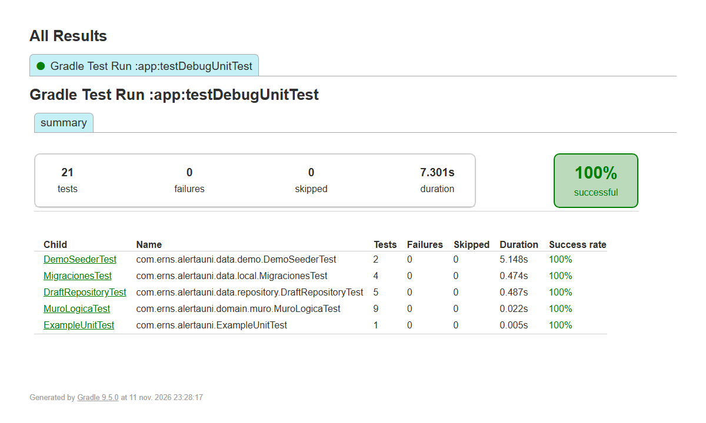

| Clase | Prueba | Qué comprueba |
|---|---|---|
| `MuroLogicaTest` | `busqueda_ignoraMayusculasYTildes` | «practica» encuentra «Práctica» |
| | `filtro_porTextoEnTituloOContenido` | Coincidencias en título **o** contenido (p. ej. «calculadora») |
| | `filtro_combinaCriterios` | Texto + tipo + curso + prioridad se combinan (Y) |
| | `filtro_separaArchivadosDelMuroPrincipal` | Los archivados no salen en el muro y sí en «Archivados» |
| | `filtro_limpioConservaSoloLaVista` | «Quitar filtros» vuelve a la lista completa |
| | `resaltado_devuelveRangosDelTextoOriginal` | El resaltado marca las letras correctas |
| | `resaltado_conTildeDescompuesta_mapeaBienLosIndices` | Resaltado correcto con tildes en otra codificación |
| | `fecha_amigable` | «Hoy, 09:15», «Ayer, …», «Jue 5 nov, …» |
| | `fecha_grupos` | Grupos Hoy / Esta semana / Anteriores |
| `DraftRepositoryTest` | `guardarYRecuperar_conservaTodosLosCampos` | Guardar y recuperar un borrador completo |
| | `guardarDeNuevo_actualizaElMismoBorrador` | Volver a guardar no duplica |
| | `eliminarYDeshacer` | Eliminar y recuperar con «Deshacer» |
| | `borradoresAisladosPorCuenta` | Otra cuenta no ve ni abre los borradores |
| | `persisteEnLaBaseAlReabrir` | El borrador sigue tras cerrar y abrir la base |
| `MigracionesTest` | `migracion2a3_conservaNotificacionesYCreaPostExtra` | Migración 2→3 sin pérdida de datos |
| | `migracion3a4_creaTablasDemoSinTocarDatosPrevios` | Migración 3→4 |
| | `migracion4a5_creaTablaDeBorradores` | Migración 4→5 (tabla `drafts`) |
| | `migracionCompleta2a5_conservaNotificaciones` | De la base original a la actual sin perder notificaciones |
| `DemoSeederTest` | `siembra40AnunciosVariados` | 40 anuncios con todas las variantes (tipos, prioridades, fechas, longitudes, casos borde) |
| | `noDuplicaSiYaHayDatos` | Los datos de prueba no se duplican al reabrir |
| `ExampleUnitTest` | `addition_isCorrect` | Prueba de ejemplo del proyecto original |

---

## 2. Funcionalidades nuevas (manuales en el emulador)

Todas se ejecutaron con la cuenta **Docente Demo A**, salvo B07, que usa también la B.

### Muro, búsqueda y filtros

#### F02 · Muro rediseñado — ✅ Aprobado
**Pasos:** abrir la app → «Entrar como Docente Demo A» → desplazarse.
**Esperado:** tarjetas con curso, chip de tipo, prioridad (franja y chip), título, resumen de 2 líneas, fecha amigable y nº de comentarios, sin autor; grupos HOY / ESTA SEMANA / ANTERIORES.
**Obtenido:** como se esperaba.

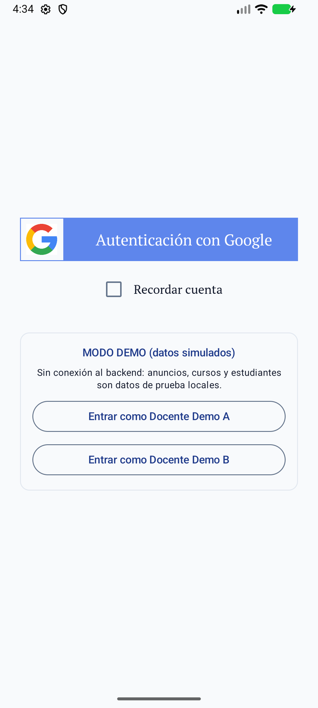  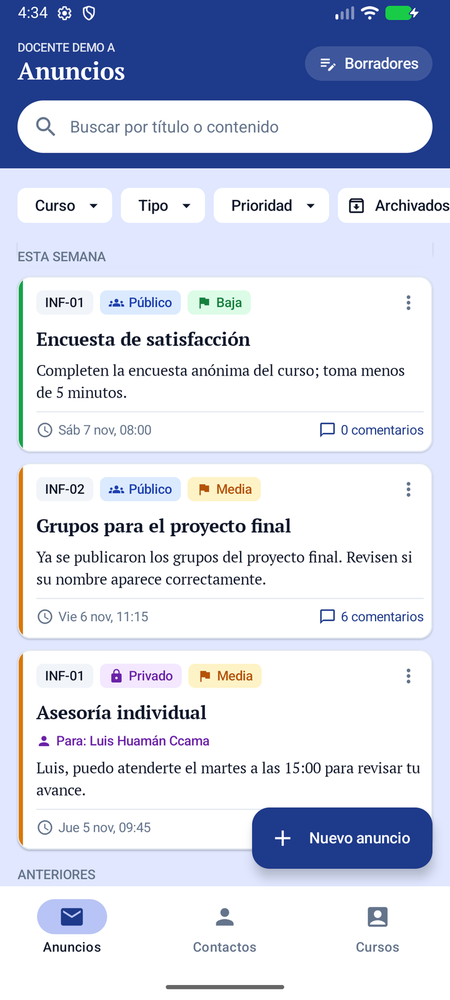

#### F03 · El botón «Nuevo anuncio» no tapa la última tarjeta — ✅ Aprobado
**Pasos:** desplazarse hasta el final del muro.
**Esperado:** la última tarjeta se ve completa por encima del botón.
**Obtenido:** «Presentación del curso» se ve entera.

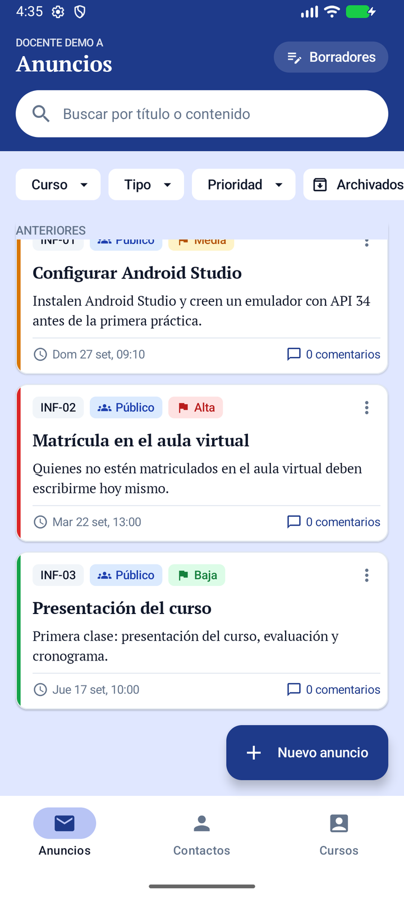

#### F04 · Búsqueda sin distinguir tildes ni mayúsculas — ✅ Aprobado (tras corrección)
**Pasos:** tocar el buscador y escribir `practica`.
**Esperado:** encuentra «Práctica…», resalta las coincidencias y muestra el número de resultados.
**Obtenido:** «8 resultados para «practica»», con las coincidencias resaltadas (incluye el anuncio creado en F20).
**Problema encontrado y corregido:** en la primera ejecución la línea «N resultados…» quedaba fuera de la pantalla hasta que el usuario subía la lista. Se corrigió en `PostScreen.kt` y se volvió a probar.

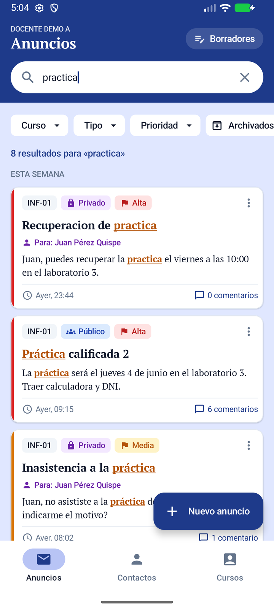

#### F06 · Mensaje cuando no hay resultados — ✅ Aprobado
**Pasos:** buscar `examen de fisica nuclear`.
**Esperado:** mensaje explicativo y salidas «Quitar filtros» y «Buscar también en archivados».
**Obtenido:** como se esperaba.

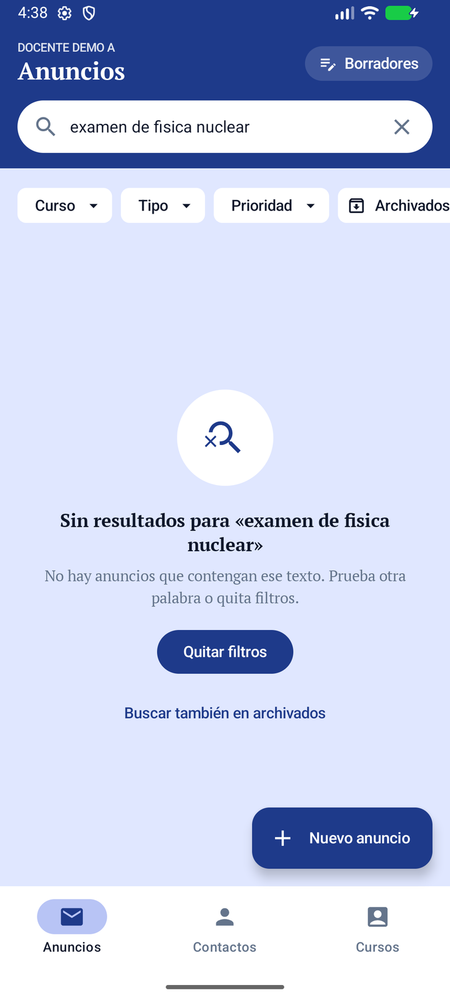

#### F07 · Volver a la lista completa — ✅ Aprobado
**Pasos:** desde F06, tocar «Quitar filtros».
**Esperado:** se borra la búsqueda y vuelve el muro completo.
**Obtenido:** como se esperaba.

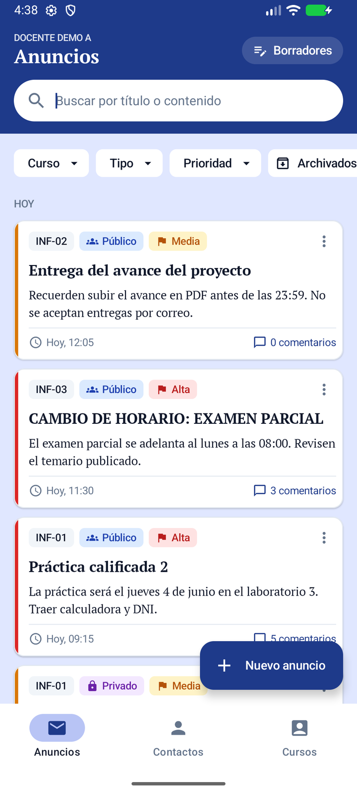

#### F08 · Filtro por prioridad — ✅ Aprobado
**Pasos:** chip «Prioridad» → «Alta».
**Esperado:** solo anuncios de prioridad Alta y resumen del filtro.
**Obtenido:** «11 resultados · de prioridad Alta», todos con prioridad Alta.

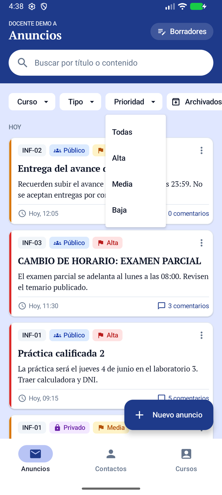 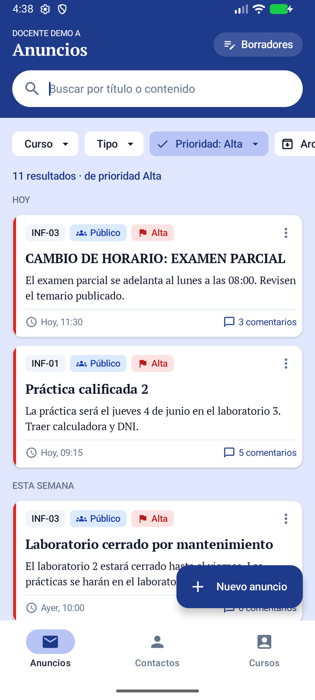

### Gestión de anuncios

#### F10 · Vista de archivados — ✅ Aprobado
**Pasos:** chip «Archivados».
**Esperado:** solo los archivados, atenuados, con «Restaurar al muro».
**Obtenido:** «2 anuncios archivados · no aparecen en el muro principal».

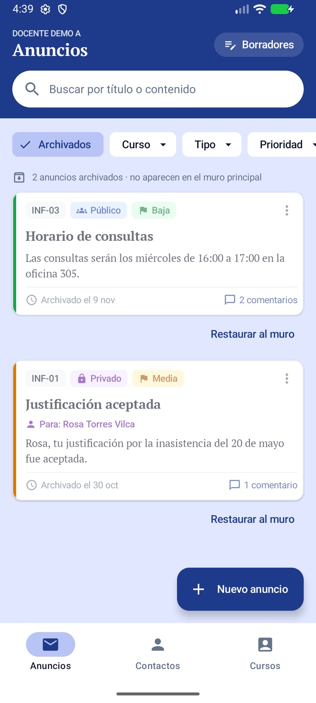

#### F12 · Restaurar un archivado — ✅ Aprobado
**Pasos:** en Archivados, «Restaurar al muro» de «Horario de consultas».
**Esperado:** vuelve al muro y se confirma.
**Obtenido:** aviso «Horario de consultas» volvió al muro y queda 1 archivado.

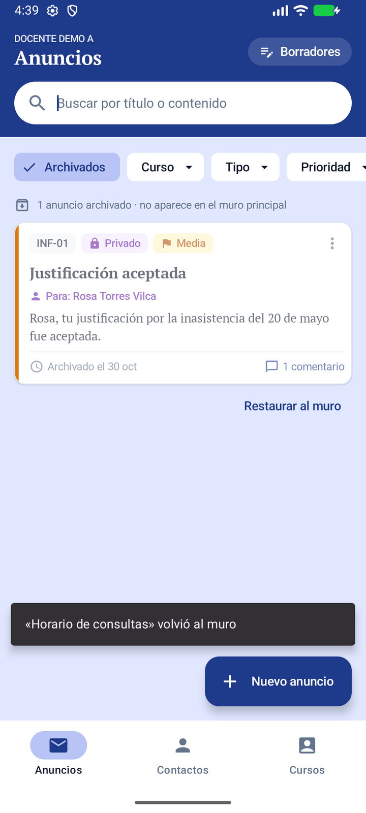

#### F13 · Menú de acciones (⋮) — ✅ Aprobado
**Pasos:** tocar ⋮ en la primera tarjeta.
**Esperado:** Ver comentarios (N), Deshabilitar/Habilitar comentarios y Archivar.
**Obtenido:** como se esperaba.

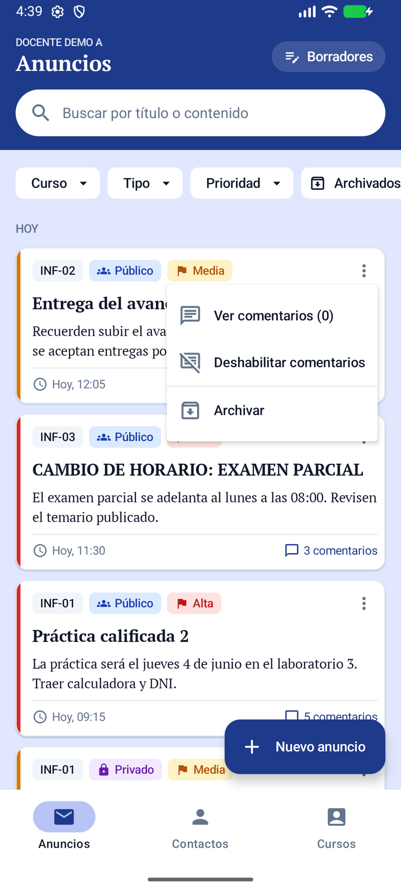

#### F11 · Archivar con «Deshacer» — ✅ Aprobado
**Pasos:** ⋮ → Archivar → «Deshacer».
**Esperado:** el anuncio sale del muro sin diálogo y vuelve al deshacer.
**Obtenido:** aviso «… archivado · Deshacer»; al deshacer, el anuncio vuelve a su lugar.

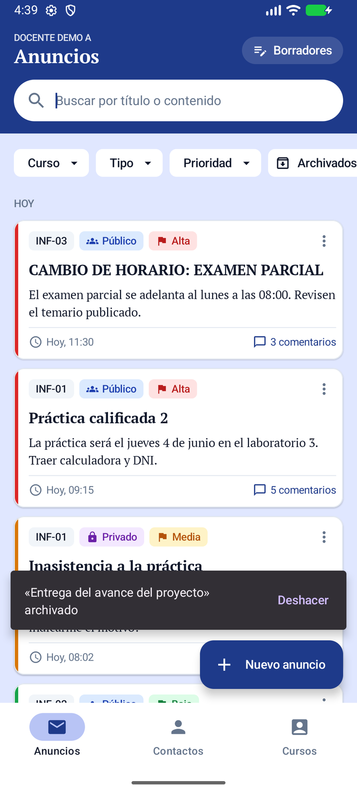 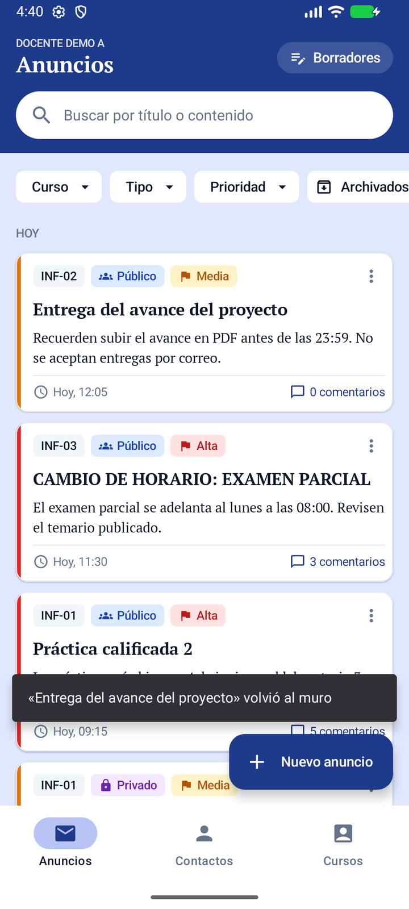

#### F14 · Comentarios deshabilitados — ✅ Aprobado
**Pasos:** buscar `plagio` → abrir «Plagio detectado».
**Esperado:** aviso de comentarios cerrados, comentarios previos visibles y entrada bloqueada con candado.
**Obtenido:** como se esperaba.

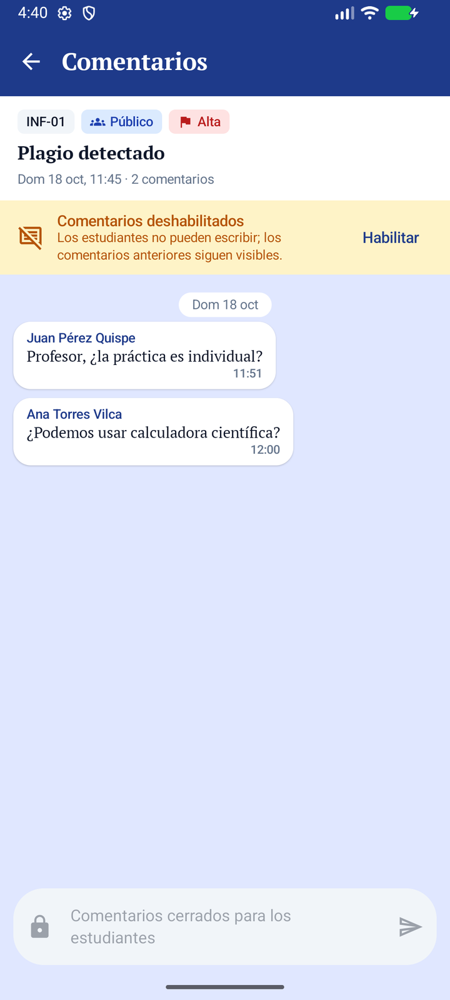

#### F15 · Habilitar comentarios y comentar — ✅ Aprobado
**Pasos:** en F14, «Habilitar» → escribir → enviar.
**Esperado:** se desbloquea la entrada y el comentario aparece.
**Obtenido:** el comentario aparece bajo el separador «Hoy» y el contador pasa de 2 a 3.

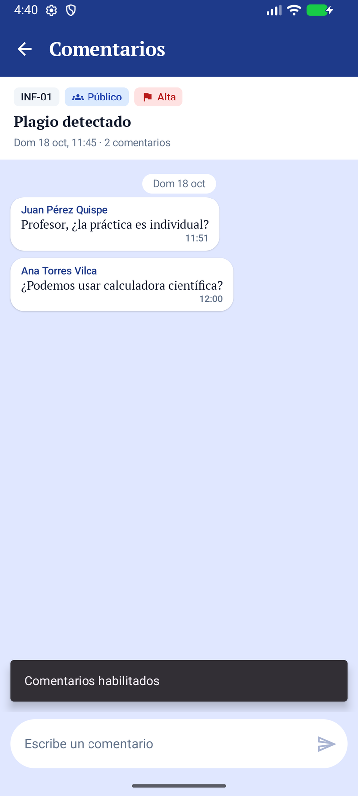 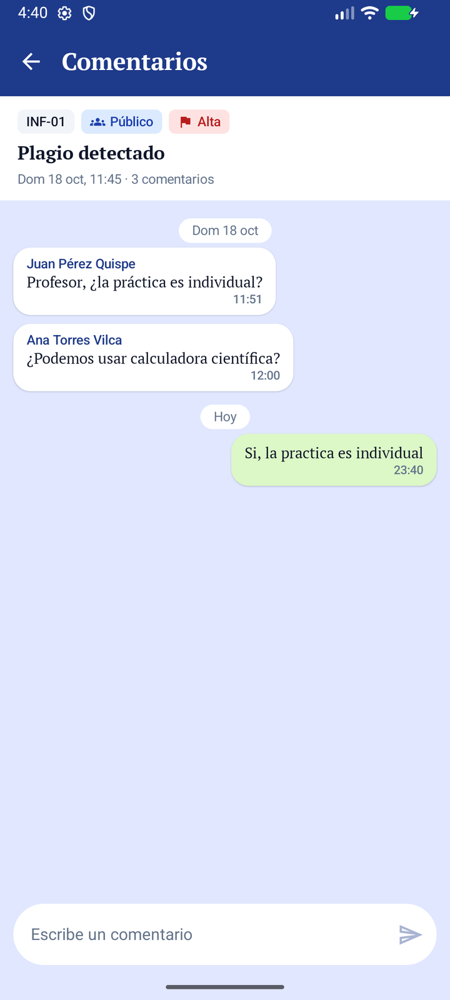

### Publicación pública y privada

#### F16 · Validación del formulario — ✅ Aprobado
**Pasos:** «Nuevo anuncio» → «Publicar» sin completar nada.
**Esperado:** errores en cada campo y resumen en rojo; el botón no queda «muerto».
**Obtenido:** curso, título y contenido marcados; «Falta elegir el destinatario · Completa los 3 campos marcados».

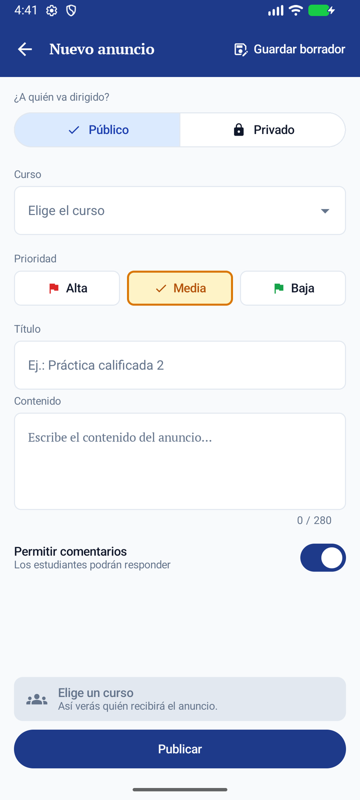 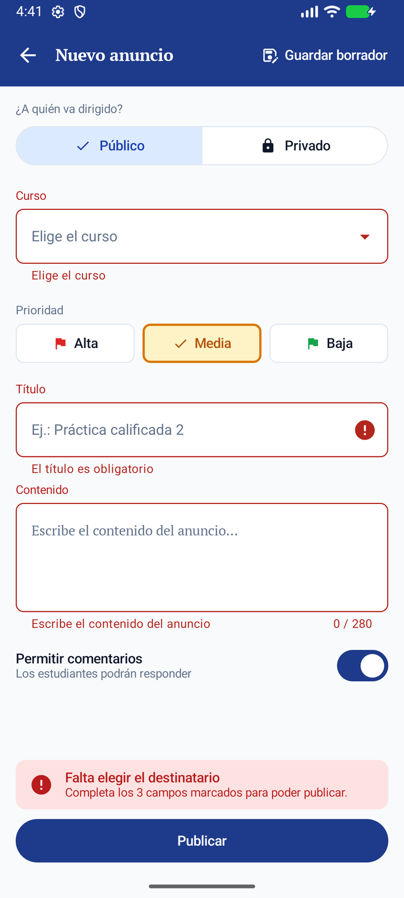

#### F17 · Selector de estudiante — ✅ Aprobado
**Pasos:** Privado → INF-01 → Estudiante → buscar `juan` → elegir.
**Esperado:** solo matriculados del curso, con búsqueda por nombre o código.
**Obtenido:** «INF-01 · 32 estudiantes matriculados»; `juan` deja 2 coincidencias.

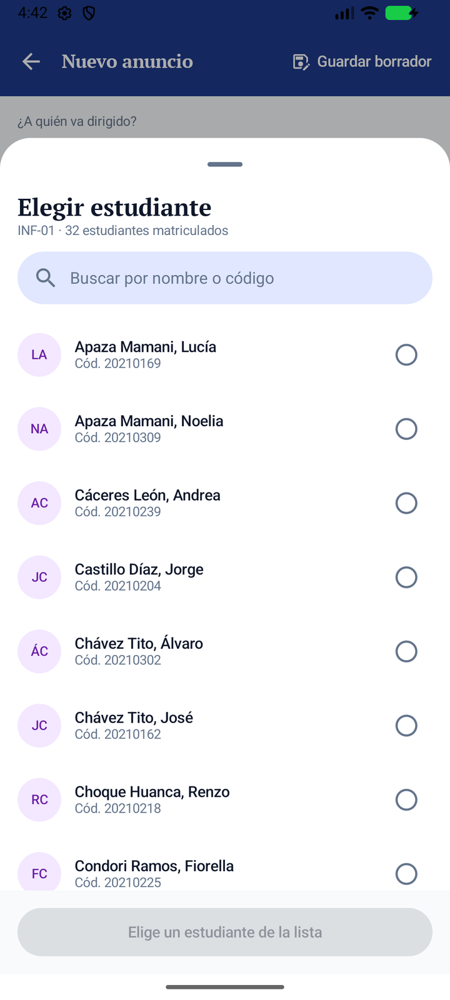 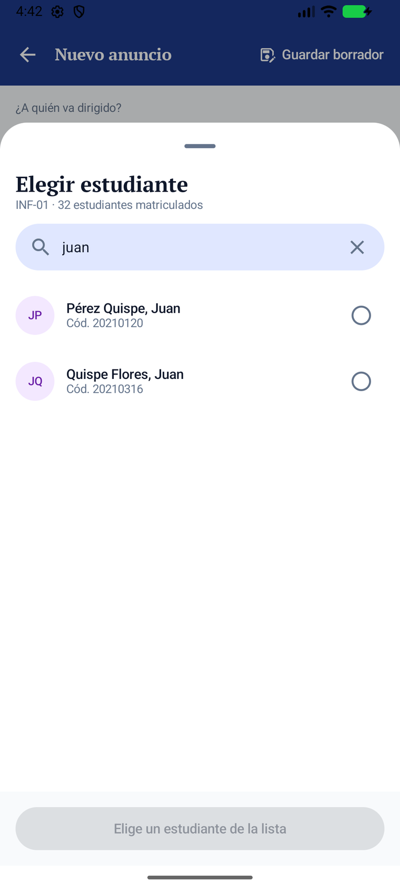 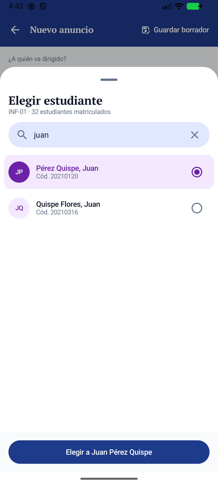

#### F18 · Resumen del destinatario — ✅ Aprobado
**Pasos:** completar título, contenido y prioridad Alta.
**Esperado:** «Lo recibirá solo: Juan Pérez Quispe» y botón «Enviar a Juan Pérez».
**Obtenido:** como se esperaba.

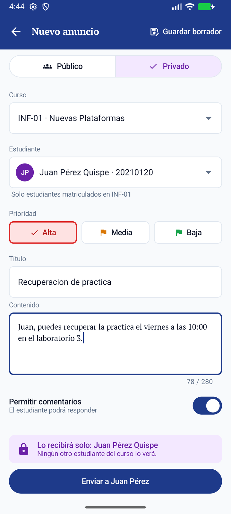

#### F19 · Confirmación solo en anuncios privados — ✅ Aprobado
**Pasos:** «Enviar a Juan Pérez»; y, aparte, publicar un anuncio público (F24).
**Esperado:** diálogo de confirmación solo en el privado.
**Obtenido:** el privado muestra «¿Enviar anuncio privado?» con el resumen; el público se publica directamente (ver F24).

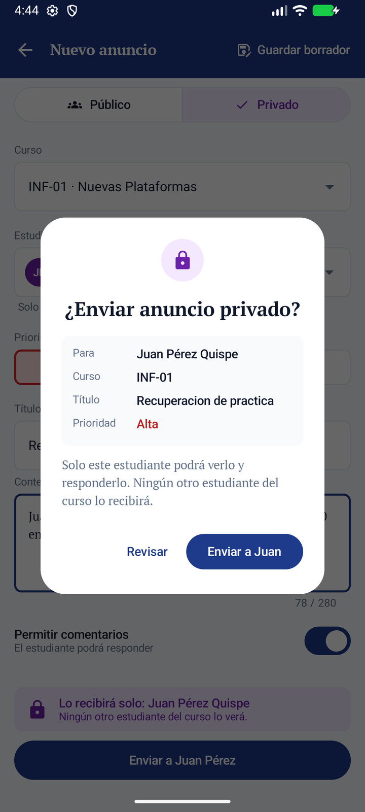 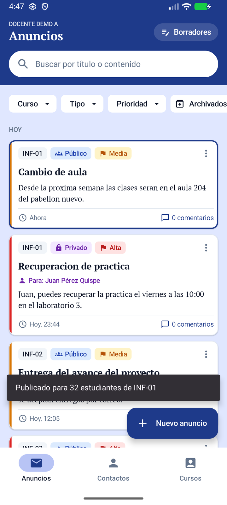

#### F20 · Publicar un anuncio privado — ✅ Aprobado
**Pasos:** confirmar con «Enviar a Juan».
**Esperado:** vuelve al muro, que se recarga, resalta el anuncio nuevo y confirma.
**Obtenido:** aviso «Enviado solo a Juan Pérez Quispe»; tarjeta nueva resaltada con «Ahora».

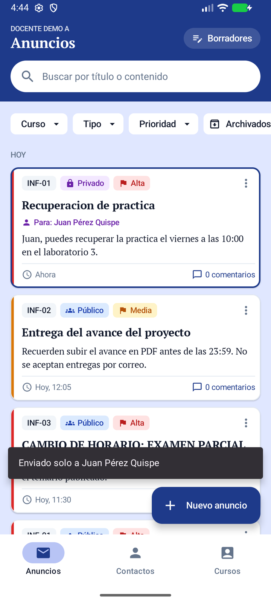

#### F21 · Destinatario visible en el muro y en Comentarios — ✅ Aprobado
**Pasos:** ver la tarjeta y abrirla.
**Esperado:** «Para: Juan Pérez Quispe».
**Obtenido:** visible en la tarjeta y en la cabecera de Comentarios.

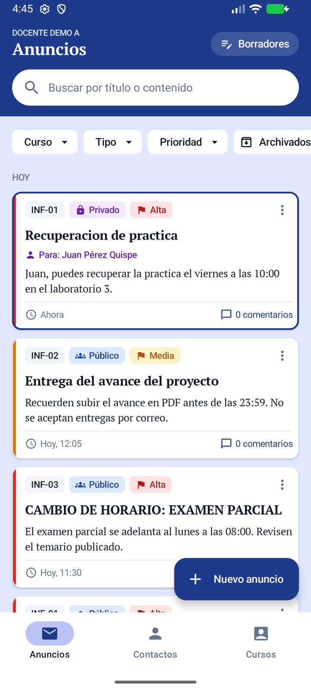 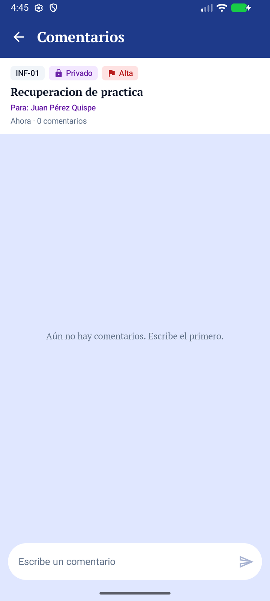

#### F22 · Cambiar de curso borra el estudiante elegido — ✅ Aprobado
**Pasos:** Privado → INF-01 → elegir a Luis Huamán Ccama → cambiar el curso a INF-02.
**Esperado:** el estudiante se borra, porque no pertenece al nuevo curso.
**Obtenido:** el campo vuelve a «Selecciona un estudiante» y el resumen pide «Elige el estudiante».

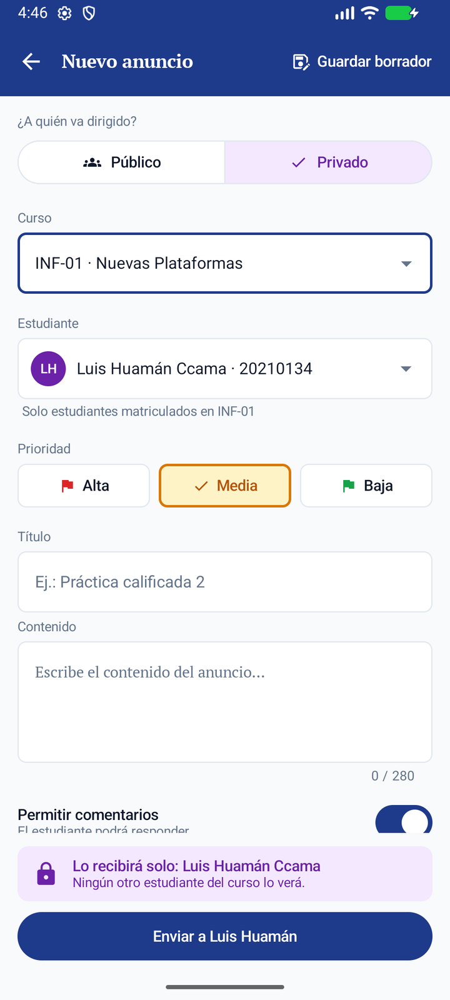 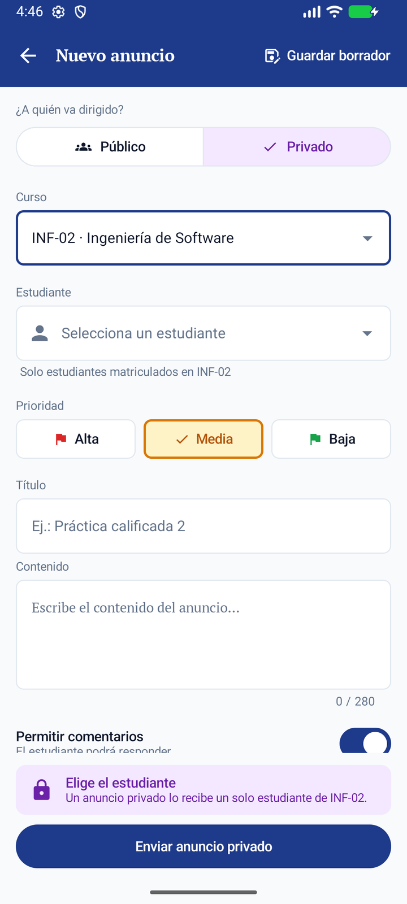

#### F23 · Atajo desde Contactos — ✅ Aprobado
**Pasos:** Contactos → INF-01 → ícono Enviar junto a «Huamán Ccama, Luis».
**Esperado:** formulario con Privado, curso y estudiante ya elegidos.
**Obtenido:** como se esperaba.

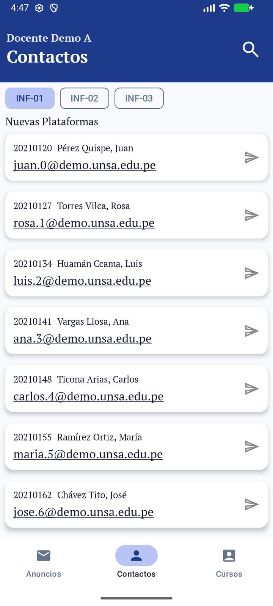 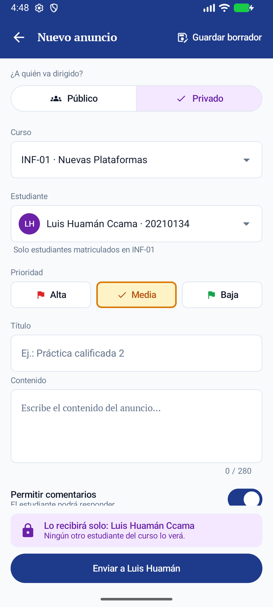

#### F24 · Publicar un anuncio público — ✅ Aprobado
**Pasos:** Nuevo anuncio → INF-01 → título y contenido → «Publicar para 32 estudiantes».
**Esperado:** se publica sin diálogo y aparece arriba como «Ahora».
**Obtenido:** aviso «Publicado para 32 estudiantes de INF-01».

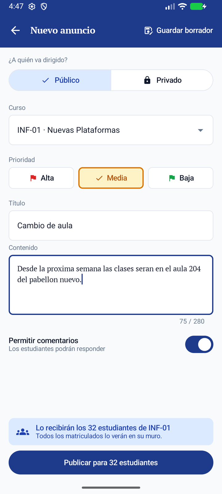 

### Borradores (Tarea 3)

#### B01 · Guardar un borrador — ✅ Aprobado
**Pasos:** en el formulario (abierto desde Contactos para Luis Huamán Ccama), escribir título y contenido → «Guardar borrador».
**Esperado:** se guarda y se confirma.
**Obtenido:** aviso «Borrador guardado. Lo encontrarás en «Borradores»»; la barra pasa a «Editar borrador».

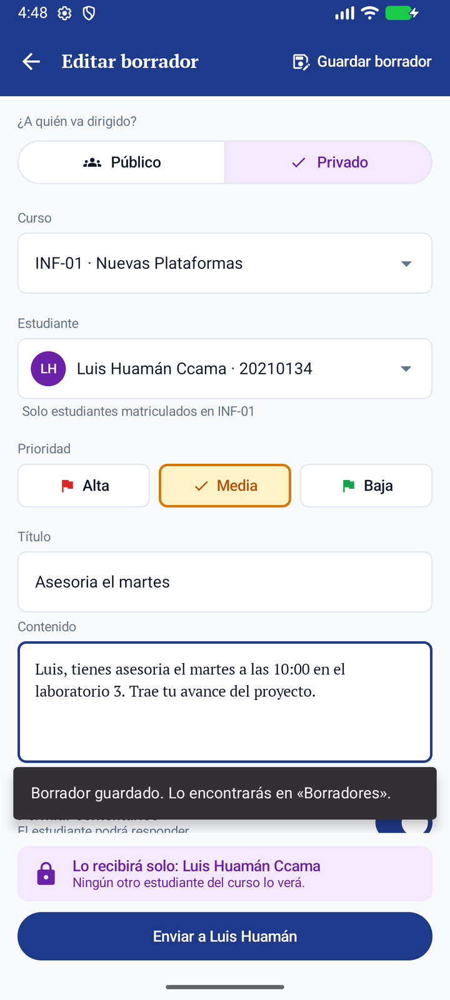

#### B02 · Aviso al salir con cambios — ✅ Aprobado
**Pasos:** escribir un anuncio y tocar ←.
**Esperado:** «Guardar borrador / Descartar / Seguir editando».
**Obtenido:** como se esperaba.

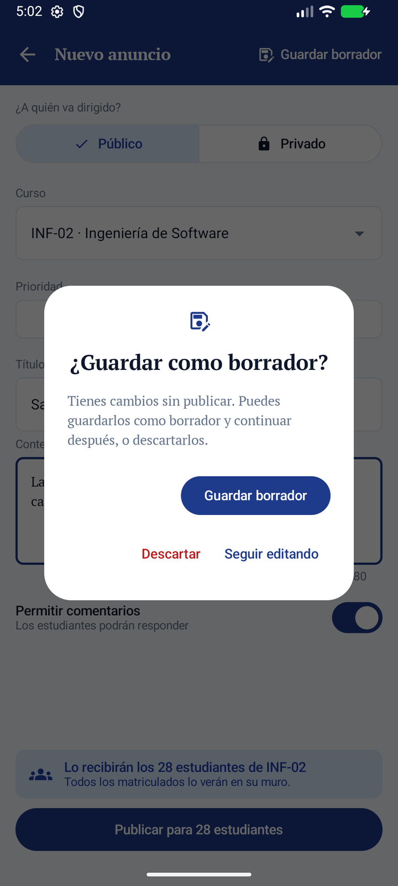

#### B03 · Borradores distinguibles de los publicados — ✅ Aprobado
**Pasos:** muro → «Borradores».
**Esperado:** borde discontinuo, fondo gris y etiqueta BORRADOR.
**Obtenido:** como se esperaba, con «Continuar» y «Eliminar».

#### B04 · Continuar editando — ✅ Aprobado
**Pasos:** «Continuar».
**Esperado:** formulario «Editar borrador» con todos los datos.
**Obtenido:** tipo, curso, estudiante, prioridad, título y contenido recuperados.

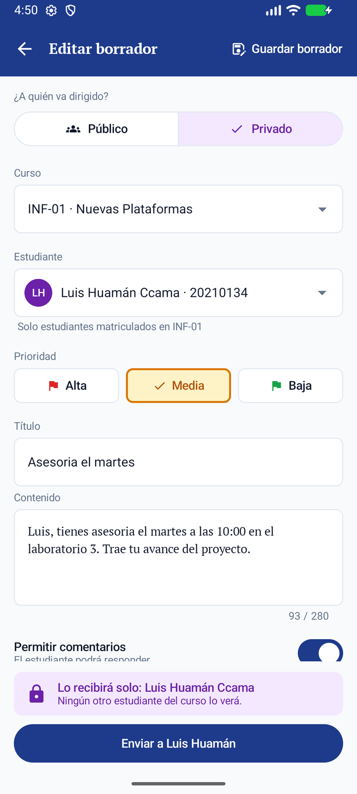

#### B05 · El borrador se conserva al cerrar la app — ✅ Aprobado
**Pasos:** cerrar la app a la fuerza (`am force-stop`) → abrirla → entrar como Docente Demo A → «Borradores».
**Esperado:** el borrador sigue ahí.
**Obtenido:** sigue ahí; el botón del muro muestra el contador «1». La sesión demo no se recuerda al cerrar la app, por eso se vuelve a entrar.

 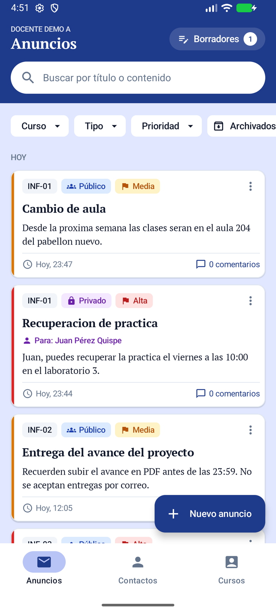 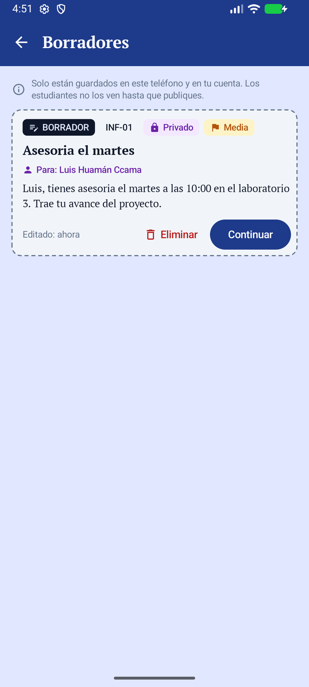

#### B07 · Los borradores de una cuenta no se ven en otra — ✅ Aprobado
**Pasos:** con el borrador de la cuenta A guardado, cerrar la app → entrar como Docente Demo B → «Borradores» → volver a entrar como A.
**Esperado:** B no ve el borrador de A; A lo conserva.
**Obtenido:** B ve «No tienes borradores»; A sigue teniendo su borrador.

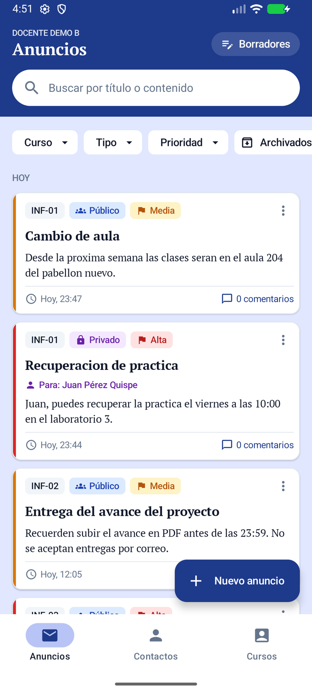 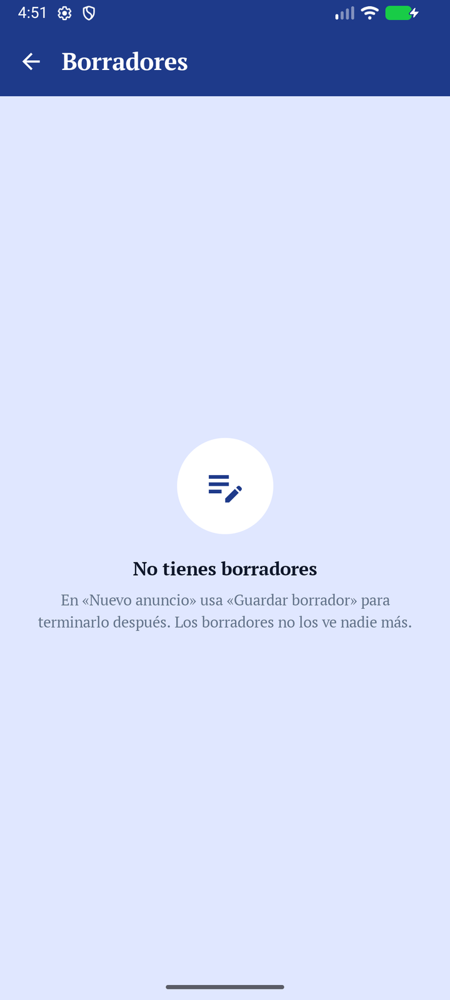 

#### B06 · Publicar un borrador lo elimina de Borradores — ✅ Aprobado
**Pasos:** «Continuar» → «Enviar a Luis Huamán» → confirmar → abrir «Borradores».
**Esperado:** se publica y desaparece de la lista.
**Obtenido:** aviso «Enviado solo a Luis Huamán Ccama» y Borradores vacío.

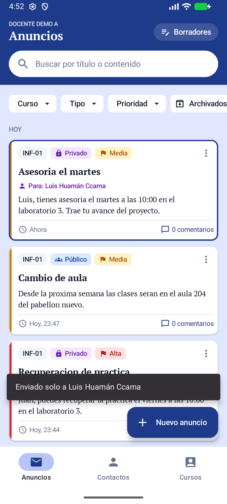 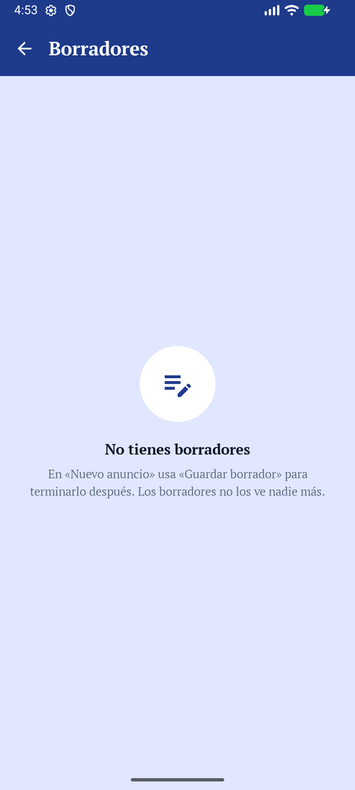

---

## 3. Regresión de funcionalidades existentes

#### R01 · Navegación inferior — ✅ Aprobado
**Pasos:** cambiar entre Anuncios, Contactos y Cursos.
**Obtenido:** cada pestaña se abre; la barra se oculta en el formulario, Comentarios y Borradores (ver F16, F14, B03).

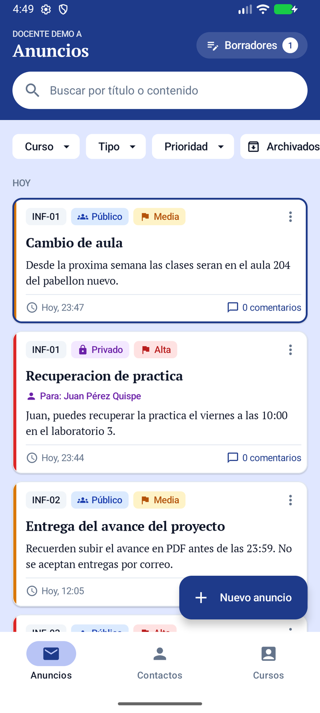 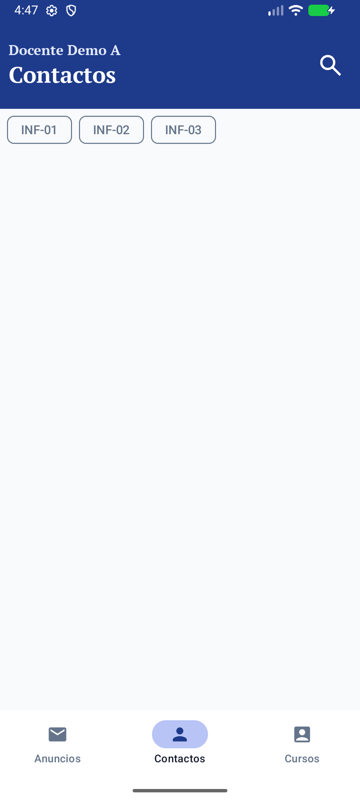 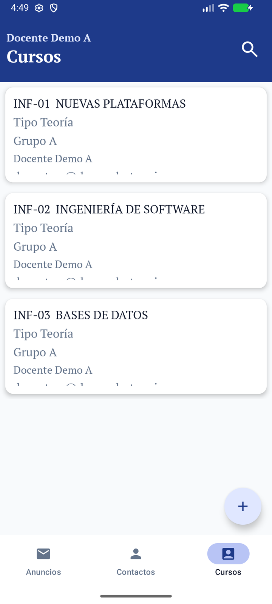

#### R02 · Comentarios: ver y enviar — ✅ Aprobado
**Pasos:** abrir los comentarios de «Práctica calificada 2» y enviar uno.
**Obtenido:** se ven los 5 comentarios y el nuevo aparece bajo «Hoy» (contador: 6).

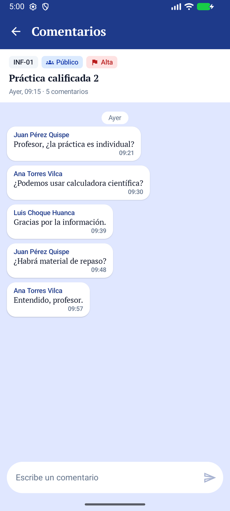 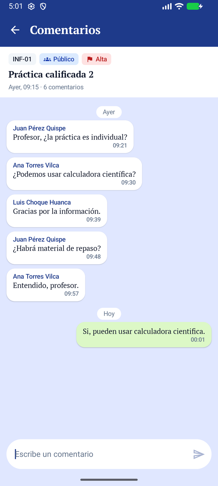

#### R03 · Contactos: cursos y estudiantes — ✅ Aprobado
**Obtenido:** chips de los 3 cursos; INF-01 lista a sus estudiantes con código, correo e ícono Enviar.

 

#### R04 · Cursos del docente — ✅ Aprobado
**Obtenido:** lista de los 3 cursos con tipo, grupo y docente (pantalla original, sin cambios).

