# Pruebas de tamaños y orientación de pantalla — AlertaUNI

## 1. Objetivo

Verificar la adaptación visual de las vistas **Muro de anuncios** y **Nuevo anuncio** de AlertaUNI ante distintos tamaños y orientaciones de pantalla, con el propósito de identificar problemas de distribución, visibilidad del contenido y aprovechamiento del espacio disponible.

Se evaluaron **12 casos**: dos vistas, tres tamaños de pantalla (**pequeño, mediano y grande**) y dos orientaciones (**vertical y horizontal**).

## 2. Entorno de prueba

| Elemento | Descripción |
|---|---|
| Aplicación | AlertaUNI |
| Dispositivo | Emulador Android `Medium_Phone` |
| Resolución base | 1080 × 2400 px |
| Densidad base | 420 dpi |
| Compilación | `debug`, en modo demo |
| Sesión utilizada | Docente Demo A, con anuncios de prueba |
| Método | Ajuste de resolución y densidad con ADB y cambio de orientación del emulador |
| Evidencias | 12 capturas de pantalla |

### Configuraciones evaluadas

| ID | Tamaño | Resolución (px) | Densidad | Orientación |
|:--:|---|---:|---:|---|
| P1 | Pequeño | 720 × 1280 | 320 dpi | Vertical |
| P2 | Pequeño | 1280 × 720 | 320 dpi | Horizontal |
| P3 | Mediano | 1080 × 2400 | 420 dpi | Vertical |
| P4 | Mediano | 2400 × 1080 | 420 dpi | Horizontal |
| P5 | Grande | 1440 × 3120 | 560 dpi | Vertical |
| P6 | Grande | 3120 × 1440 | 560 dpi | Horizontal |

## 3. Criterios de evaluación

La revisión consideró los siguientes aspectos:

1. **Distribución:** disposición de cabeceras, tarjetas, formularios y barras de navegación según el tamaño disponible.
2. **Visibilidad del contenido:** presencia de anuncios en el muro y de los elementos principales del formulario.
3. **Legibilidad:** presentación clara de textos, etiquetas y controles visibles.
4. **Adaptación a la orientación:** conservación de una disposición utilizable al pasar de vertical a horizontal.
5. **Aprovechamiento del espacio:** ausencia de restricciones de diseño que impidan visualizar el contenido principal.

**Estados utilizados:**

- **Aprobado:** la captura muestra una adaptación visual aceptable para la configuración evaluada.
- **No aprobado:** se identifica un problema de visualización que afecta al contenido principal de la vista.

## 4. Resumen de resultados

| ID | Tamaño | Orientación | Muro de anuncios | Nuevo anuncio |
|:--:|---|---|---|---|
| P1 | Pequeño | Vertical | **Aprobado** | **Aprobado** |
| P2 | Pequeño | Horizontal | **No aprobado** | **Aprobado** |
| P3 | Mediano | Vertical | **Aprobado** | **Aprobado** |
| P4 | Mediano | Horizontal | **Aprobado** | **Aprobado** |
| P5 | Grande | Vertical | **Aprobado** | **Aprobado** |
| P6 | Grande | Horizontal | **Aprobado** | **Aprobado** |

| Indicador | Resultado |
|---|---:|
| Casos evaluados | **12** |
| Casos aprobados | **11** |
| Casos no aprobados | **1** |
| Vista con incidencia | **Muro de anuncios** |
| Configuración afectada | **P2 — Pequeño, horizontal** |

## 5. Evidencias de la vista «Muro de anuncios»

### 5.1. Pantalla pequeña — P1 y P2

| P1 — Vertical · **Aprobado** | P2 — Horizontal · **No aprobado** |
|---|---|
| 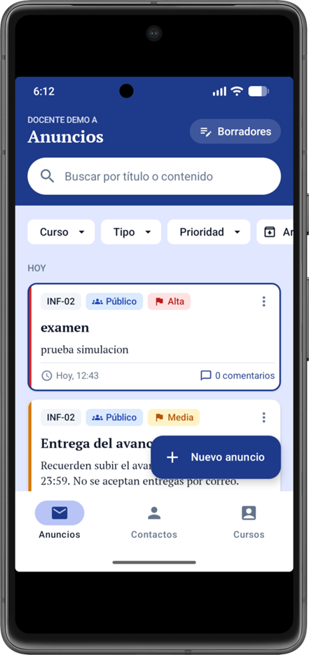 | 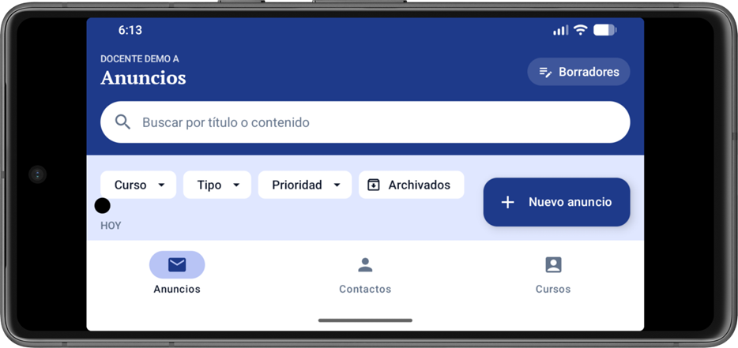 |

- **P1 — Aprobado:** se visualizan anuncios, buscador, filtros y navegación principal. La interfaz presenta el contenido del muro en orientación vertical.
- **P2 — No aprobado:** **no se visualiza ningún anuncio**. La cabecera, el buscador, los filtros y los controles ocupan el espacio disponible, dejando el área principal sin tarjetas de anuncios visibles. Esta configuración presenta un problema de aprovechamiento de la altura en orientación horizontal.

### 5.2. Pantalla mediana — P3 y P4

| P3 — Vertical · **Aprobado** | P4 — Horizontal · **Aprobado** |
|---|---|
| 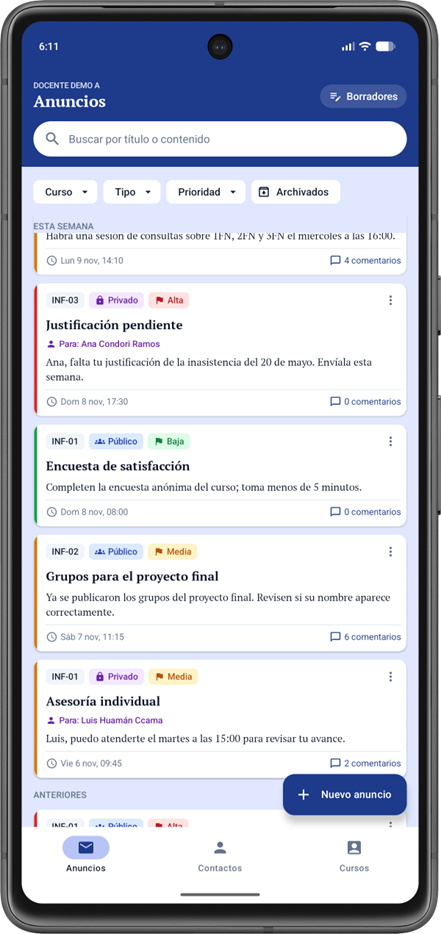 | 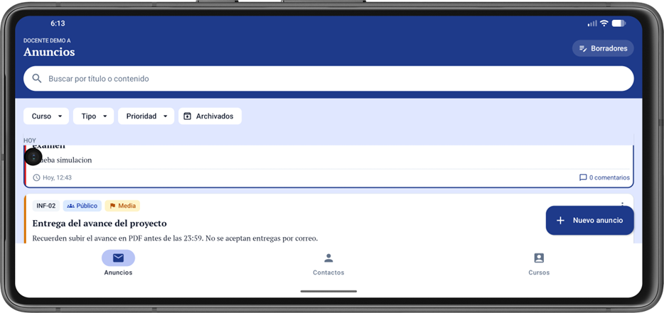 |

- **P3 — Aprobado:** el muro muestra varias tarjetas junto con sus controles de búsqueda, filtrado y navegación.
- **P4 — Aprobado:** se mantiene la visualización de anuncios y controles en horizontal, aunque se muestra una menor cantidad de contenido debido a la altura disponible.

### 5.3. Pantalla grande — P5 y P6

| P5 — Vertical · **Aprobado** | P6 — Horizontal · **Aprobado** |
|---|---|
| 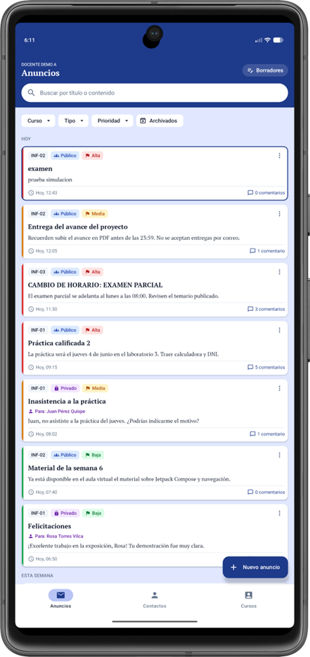 | 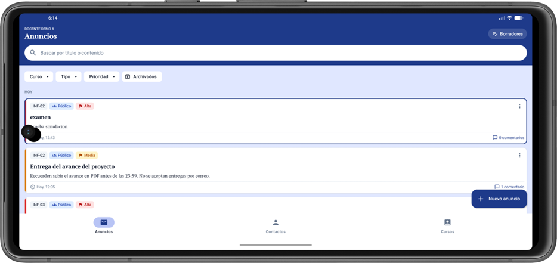 |

- **P5 — Aprobado:** se presenta una mayor cantidad de anuncios simultáneamente, con los elementos principales de la interfaz visibles.
- **P6 — Aprobado:** las tarjetas y los controles principales continúan visibles en orientación horizontal.

## 6. Evidencias de la vista «Nuevo anuncio»

### 6.1. Pantalla pequeña — P1 y P2

| P1 — Vertical · **Aprobado** | P2 — Horizontal · **Aprobado** |
|---|---|
| 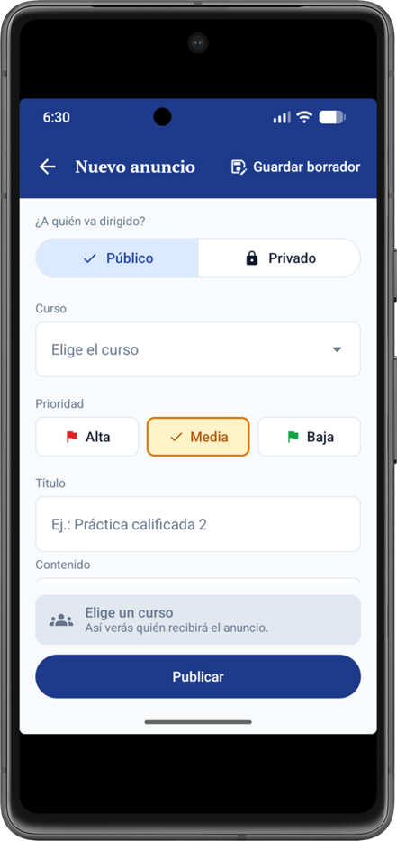 | 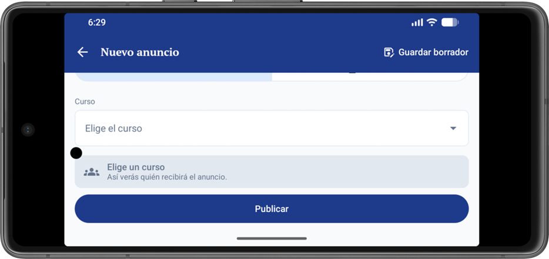 |

- **P1 — Aprobado:** se visualizan la estructura del formulario, los campos iniciales y las acciones de guardado y publicación. Por la altura de pantalla, no todos los campos aparecen simultáneamente.
- **P2 — Aprobado:** se conserva la presentación del formulario y sus controles principales en horizontal. El espacio vertical disponible reduce la cantidad de campos visibles a la vez.

### 6.2. Pantalla mediana — P3 y P4

| P3 — Vertical · **Aprobado** | P4 — Horizontal · **Aprobado** |
|---|---|
| 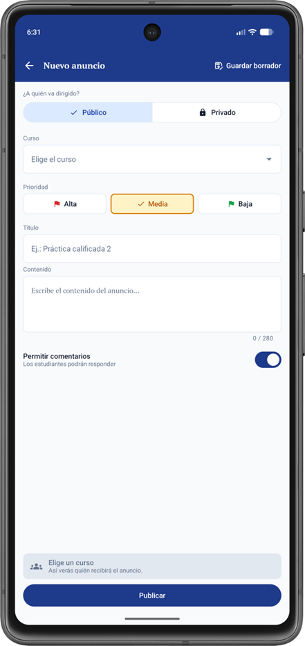 | 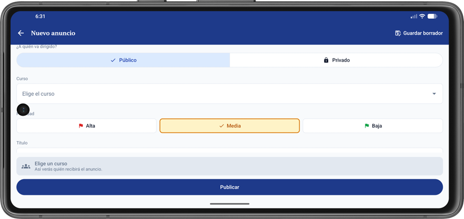 |

- **P3 — Aprobado:** se visualizan los campos del formulario, las opciones de configuración y el área de publicación con una distribución clara.
- **P4 — Aprobado:** el formulario mantiene su estructura y las acciones principales en orientación horizontal; algunos campos quedan fuera del encuadre inicial por la menor altura.

### 6.3. Pantalla grande — P5 y P6

| P5 — Vertical · **Aprobado** | P6 — Horizontal · **Aprobado** |
|---|---|
| 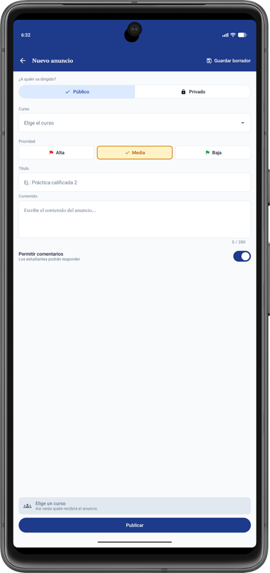 | 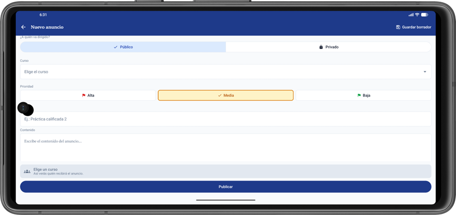 |

- **P5 — Aprobado:** se visualizan los campos, opciones y acciones del formulario con una distribución adecuada al espacio disponible.
- **P6 — Aprobado:** se mantienen visibles los campos principales y las acciones de publicación, adaptados al formato horizontal.

## 7. Incidencia identificada

| Campo | Descripción |
|---|---|
| **Código** | PT-01 |
| **Vista** | Muro de anuncios |
| **Configuración** | P2 — Pantalla pequeña, horizontal |
| **Resolución** | 1280 × 720 px; 320 dpi |
| **Resultado esperado** | Visualizar al menos una tarjeta de anuncio dentro del área principal del muro. |
| **Resultado obtenido** | No aparece ninguna tarjeta de anuncio en la captura; solo se observan los elementos superiores y de navegación. |
| **Estado** | **No aprobado** en la primera ejecución → **corregido y aprobado** en la reprueba (sección 9) |
| **Evidencia** | [`p2_muro_pequena_horizontal.png`](capturas/tamanos/p2_muro_pequena_horizontal.png) |

**Recomendación:** optimizar la distribución del muro para pantallas pequeñas en horizontal, reduciendo el espacio que ocupan los elementos superiores o priorizando el área destinada a la lista de anuncios. La mejora debe permitir que al menos una tarjeta resulte visible sin modificar la orientación.

## 8. Conclusiones

Las pruebas de tamaños y orientación de pantalla de AlertaUNI registraron **11 casos aprobados y 1 no aprobado**, a partir de las 12 capturas de las vistas **Muro de anuncios** y **Nuevo anuncio**.

La vista **Nuevo anuncio** obtuvo resultados aprobados en las seis configuraciones evaluadas. El **Muro de anuncios** obtuvo cinco resultados aprobados y presentó una incidencia en la **pantalla pequeña horizontal (P2)**, donde no se visualiza ningún anuncio debido al espacio ocupado por los elementos de la interfaz.

En general, ambas vistas muestran una adaptación visual adecuada en las configuraciones evaluadas, con una mejora puntual identificada para el muro en orientación horizontal y tamaño pequeño. La evidencia de esta prueba sirve como referencia para corregir el diseño y comprobar posteriormente la visualización de anuncios en dicha configuración.

## 9. Corrección y reprueba de PT-01

### Causa

Con 720 × 1280 px a 320 dpi, la pantalla en horizontal mide **640 × 360 dp**. Los elementos fijos del muro ocupaban casi toda esa altura:

| Elemento | Altura aproximada |
|---|---|
| Barra de estado | 24 dp |
| Cabecera (nombre, título, Borradores y buscador) | 124 dp |
| Fila de chips de filtro | 52 dp |
| Barra de navegación inferior | 80 dp |
| Barra de gestos | 16–24 dp |

Quedaban unos 50 dp para la lista, y una tarjeta mide unos 150 dp. Como la cabecera y los chips no se desplazaban, recorrer la lista tampoco liberaba espacio.

### Corrección

Se aplica **solo cuando la pantalla tiene menos de 480 dp de alto**, es decir, un teléfono en horizontal. En vertical el diseño no cambia: sigue la cabecera fija del Figma, validada en las pruebas de usabilidad.

1. **Navegación lateral:** las pestañas Anuncios, Contactos y Cursos pasan de la barra inferior a un riel vertical a la izquierda (`NavigationRail`), como recomienda Material Design para pantallas bajas. Se recuperan unos 80 dp de alto.
2. **Cabecera ocultable:** al bajar por la lista, la cabecera y los chips se ocultan; al subir, reaparecen (`nestedScroll`). La franja de la barra de estado queda fija.
3. **Mensajes de estado desplazables:** al reprobar se vio que el mensaje «Sin resultados» quedaba cortado en P2. Ahora se desplaza cuando no cabe, y al hacerlo la cabecera le cede su espacio. En vertical sigue centrado como antes.

Archivos modificados: `ui/theme/Ventana.kt` (nuevo), `navigation/MainAppNavigation.kt`, `screen/post/PostScreen.kt` y `screen/post/components/MuroComponents.kt`.

### Reprueba

Mismo emulador y configuraciones. Las vistas verticales (P1, P3 y P5) y el formulario «Nuevo anuncio» se comprobaron otra vez y no cambian.

| ID | Configuración | Antes | Después |
|:--:|---|---|---|
| P2 | Pequeño, horizontal | **No aprobado**: ninguna tarjeta visible | **Aprobado**: la primera tarjeta se ve al abrir y casi dos al desplazar |
| P4 | Mediano, horizontal | Aprobado | **Aprobado**, con más espacio para la lista |
| P6 | Grande, horizontal | Aprobado | **Aprobado**, con más espacio para la lista |

| P2 — Antes | P2 — Después, al abrir | P2 — Después, al desplazar |
|---|---|---|
|  | 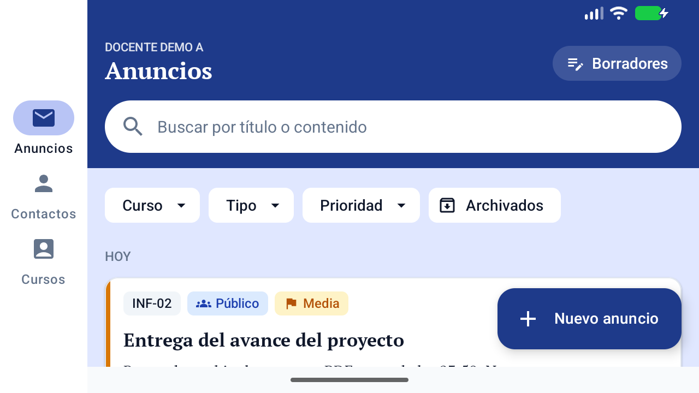 | 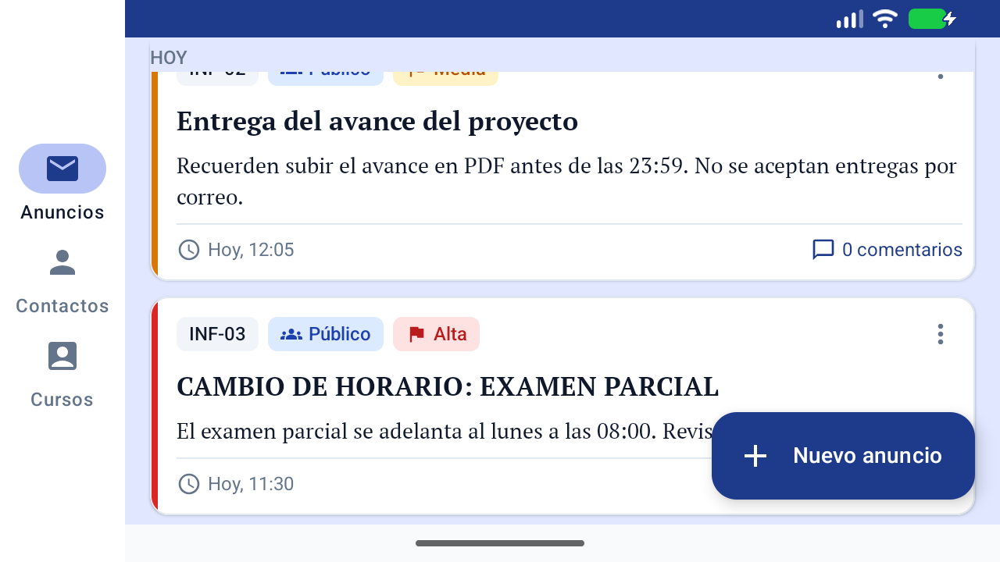 |

| P4 — Después | P6 — Después |
|---|---|
| 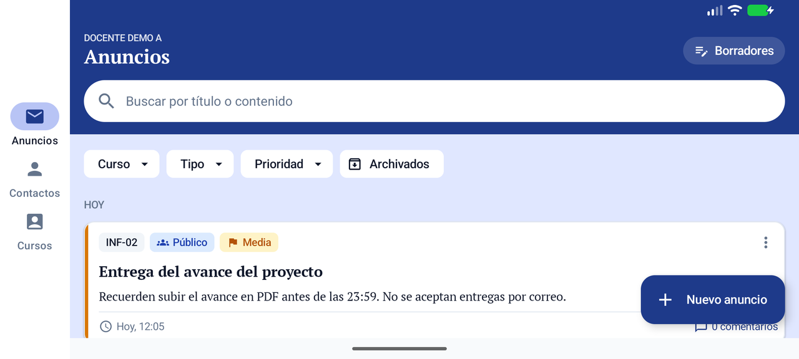 | 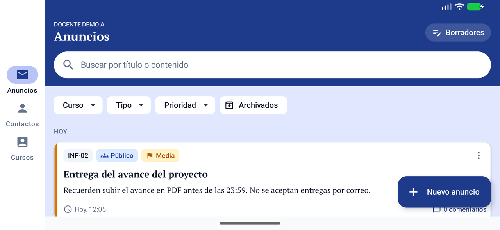 |

**Resultado final: 12 de 12 casos aprobados.** Las 21 pruebas automáticas siguen pasando tras el cambio.

