# AlertaUNI — Muro de Anuncios rediseñado (Proyecto Integrador, Parte 2)

Implementación en **Jetpack Compose** de la propuesta de diseño del Examen 2 para el **Muro de Anuncios** del docente, sobre la app AlertaUNI (Kotlin, MVVM, Hilt, Room y Supabase).

**Problema.** En la app original la búsqueda no filtraba, los anuncios privados solo se podían enviar desde Contactos, no había prioridad, archivado ni forma de cerrar los comentarios, el botón «+» tapaba la última tarjeta, las tarjetas tenían altura fija y la fecha era técnica (`2026-05-31 01:36:32`). Además, publicar con campos vacíos no hacía nada y no avisaba.

**Solución.** Se implementaron las dos alternativas elegidas en el examen:
- **Formulario único** con selector Público/Privado y resumen del destinatario.
- **Búsqueda siempre visible** con chips de filtro.

También se agregaron borradores locales con Room y un **modo demo** para probar la app sin backend.

---

## Análisis de aplicaciones similares

Antes de implementar, se revisó cómo resuelven los anuncios tres plataformas educativas conocidas. La comparación describe su funcionamiento general y puede variar según la versión o la configuración de cada institución.

| Aspecto | Google Classroom | Microsoft Teams | Moodle | AlertaUNI (esta implementación) |
|---|---|---|---|---|
| **Dónde están los anuncios** | Tablón de la clase | Publicaciones del canal del equipo | Foro «Avisos» del curso | Muro de Anuncios con todos los cursos del docente |
| **Público / privado** | Se elige el público: toda la clase o estudiantes concretos | Canal (todos) o chat individual (otra conversación) | Avisos para todo el curso; respuestas privadas solo dentro de un debate | Selector Público/Privado en el **mismo** formulario, con resumen «Lo recibirá solo: …» y confirmación |
| **Prioridad** | No tiene | Mensajes marcados como «Importante» o «Urgente» | No tiene (solo fijar un debate) | Alta / Media / Baja con color **y** texto en cada tarjeta |
| **Búsqueda** | Sin buscador en el tablón | Buscador global de mensajes | Búsqueda en foros | Buscador fijo en el muro, sin distinguir tildes, con chips de filtro |
| **Borradores** | Guardar borrador y programar | El mensaje sin enviar queda en la caja de texto | Sin borradores de avisos | Borradores en Room, separados por cuenta |
| **Comentarios** | Se configuran a nivel de clase | Respuestas en el hilo; el canal puede moderarse | Se puede bloquear un debate | Habilitar / deshabilitar por anuncio desde el menú ⋮ |

**Qué se tomó de cada una:**
- De **Classroom**, elegir el destinatario dentro del propio formulario y guardar borradores.
- De **Teams**, marcar la importancia del mensaje. Aquí se muestra en la lista y no solo al abrirlo.
- De **Moodle**, cerrar la conversación de un aviso concreto.

**Qué cubre AlertaUNI que esas plataformas no resuelven en una sola pantalla del móvil:**
- Ver la prioridad y el tipo de cada anuncio sin abrirlo.
- Buscar y filtrar dentro del muro.
- Enviar un privado sin cambiar de pantalla, con confirmación del destinatario para evitar errores.

---

## Funcionalidades y comparativa antes / después

Las capturas «antes» son de la interfaz original (vistas previas de Compose del código original con datos de ejemplo). Los números corresponden a los problemas del informe del examen. Las capturas «después» son de la app en el emulador, en modo demo.

### Muro: organización y presentación

| Antes | Después |
|---|---|
| 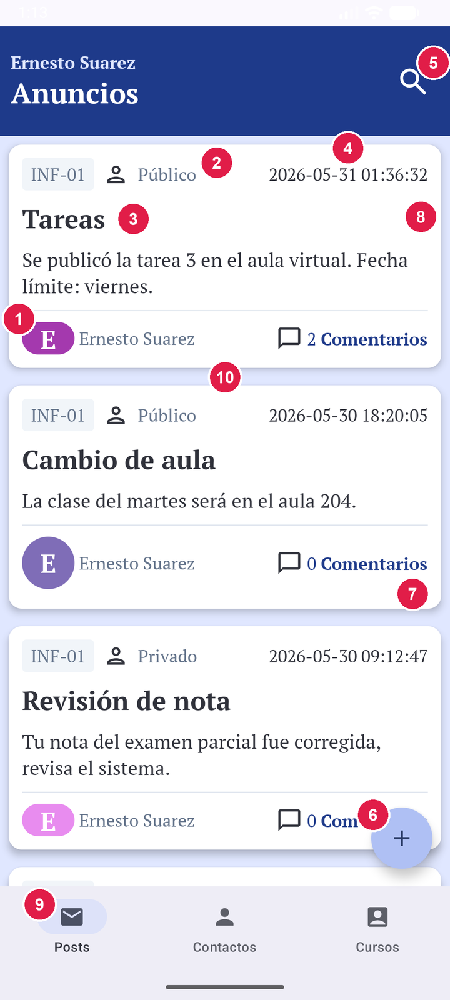 | 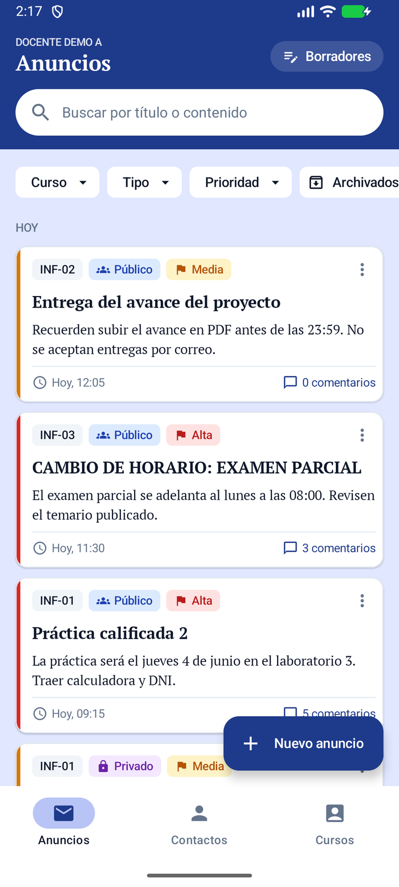 |

**Mejora:**
- **Tarjeta:**
  - Chip **Público/Privado** con ícono y palabra.
  - **Prioridad** con franja de color y chip de texto.
  - Resumen de 2 líneas y altura adaptable (antes, fija de 220 dp).
  - **Fecha amigable** («Hoy, 09:15»).
  - Sin el autor (siempre es el docente).
- **Lista:** agrupada por **Hoy / Esta semana / Anteriores**.
- **Barra inferior:** la pestaña se llama «Anuncios», igual que el título.

### Botón «Nuevo anuncio» sin tapar contenido

| Antes | Después |
|---|---|
| 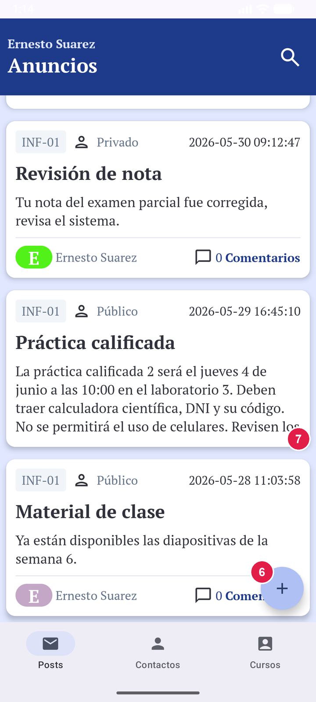 | 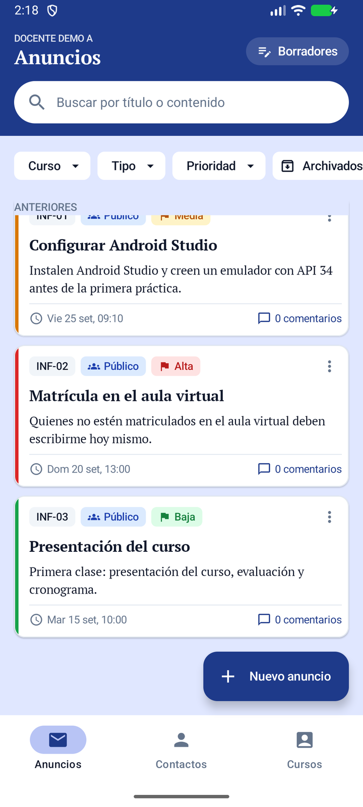 |

**Mejora:** el botón flotante ahora es extendido y tiene etiqueta. La lista reserva 88 dp al final (`contentPadding`), así que la última tarjeta se ve completa.

### Búsqueda de anuncios (Tarea 2-B)

| Antes | Después: búsqueda | Después: sin resultados |
|---|---|---|
| 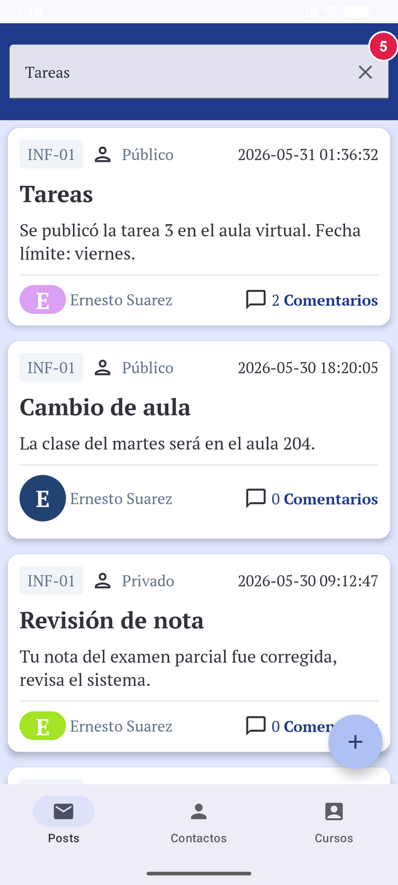 | 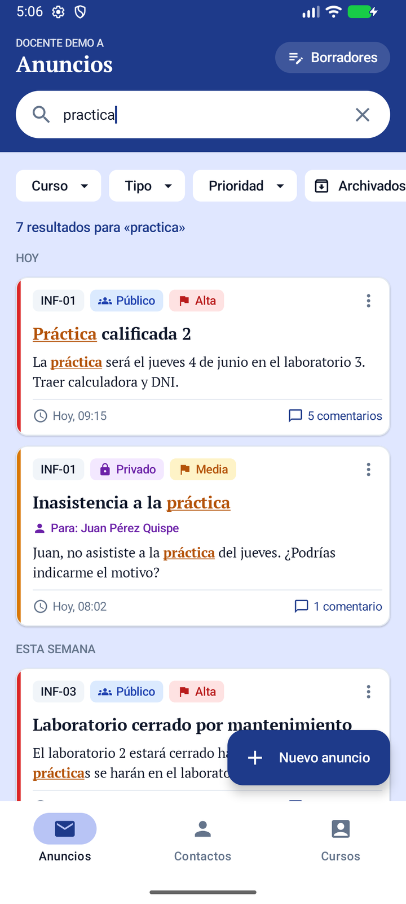 | 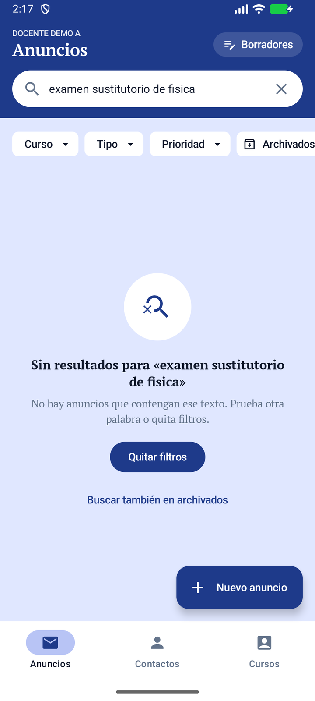 |

**Mejora:**
- **Campo de búsqueda:**
  - Siempre visible.
  - Busca en **título y contenido** sin distinguir mayúsculas ni tildes: «practica» encuentra «Práctica».
  - Resalta las coincidencias, cuenta los resultados y actualiza en vivo con un retraso de 250 ms.
  - Con ✕ se vuelve a la lista completa.
- **Chips combinables:** Curso, Tipo, Prioridad y Archivados.
- **Sin resultados:** el mensaje explica la causa y ofrece salidas («Quitar filtros», «Buscar también en archivados»).

### Publicación pública y privada (Tareas 1 y 2-A)

| Antes: público | Antes: privado (otra pestaña) | Después: formulario único |
|---|---|---|
| 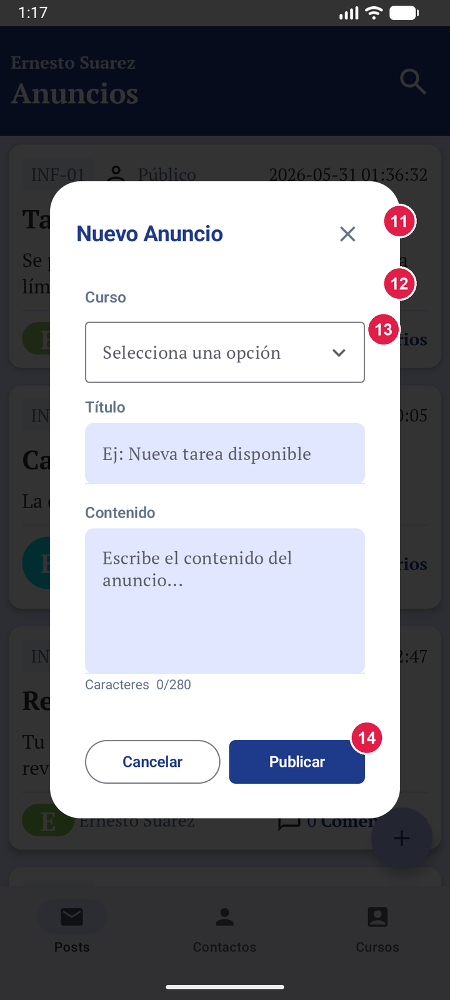 | 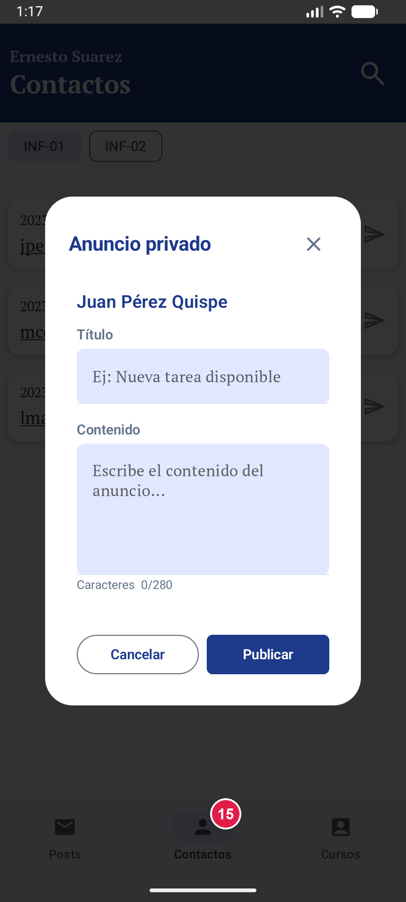 | 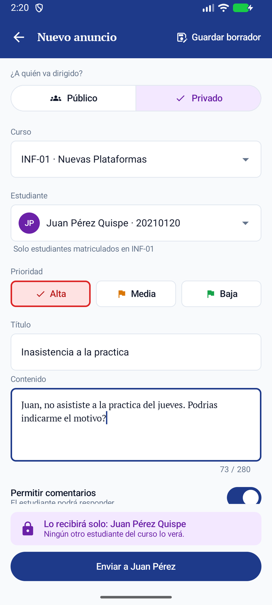 |

| Elegir estudiante | Confirmación (solo privados) | Publicado |
|---|---|---|
| 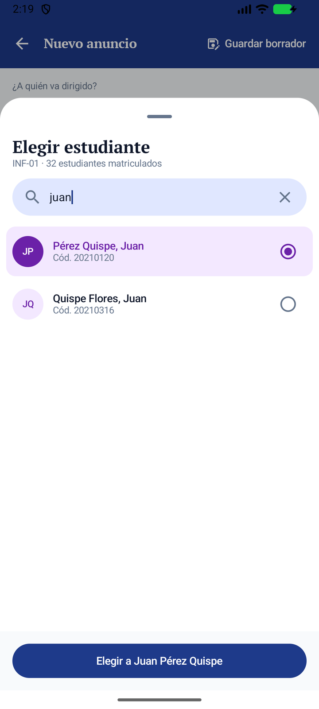 | 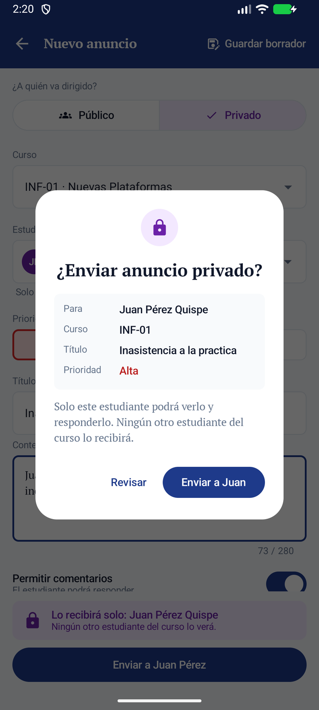 | 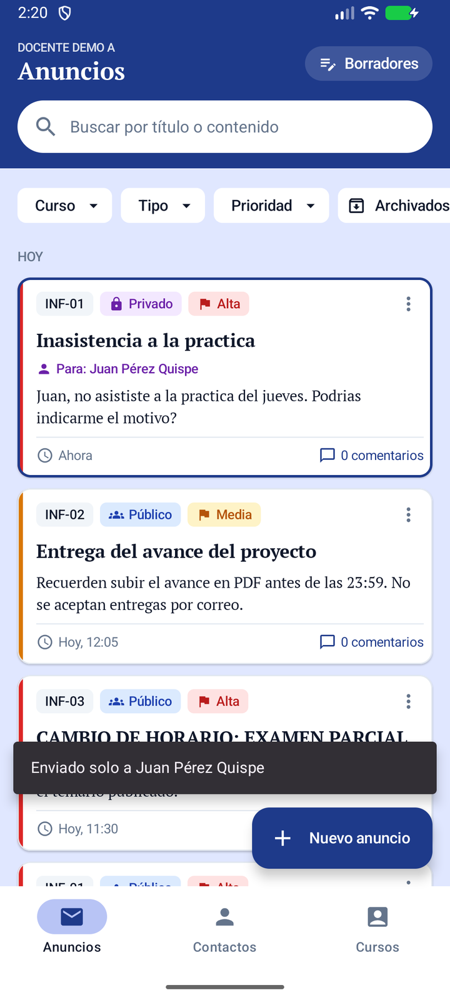 |

**Mejora:**
- **Un solo formulario.** Su primera pregunta es *¿A quién va dirigido?* y se responde con un `SingleChoiceSegmentedButtonRow`.
- **Estudiante, solo en privados.** Se elige en una hoja inferior (`ModalBottomSheet`) que lista **solo a los matriculados del curso**, con búsqueda por nombre o código. Si se cambia de curso, el estudiante elegido se borra.
- **Destinatario siempre visible:**
  - Un **resumen** fijo dice quién lo recibirá y cambia de color (azul o morado).
  - El **botón lo repite**: «Enviar a Juan Pérez» o «Publicar para 32 estudiantes».
  - Solo los privados piden **confirmación**.
- **Al publicar:**
  - La lista se recarga, el anuncio nuevo queda resaltado y un Snackbar lo confirma.
  - En el muro y en Comentarios se muestra **«Para: Nombre»**.
- **Atajo desde Contactos:** el ícono Enviar de un estudiante abre el mismo formulario con el curso y el estudiante ya elegidos.

### Prevención de errores en el formulario

| Validación en línea |
|---|
| 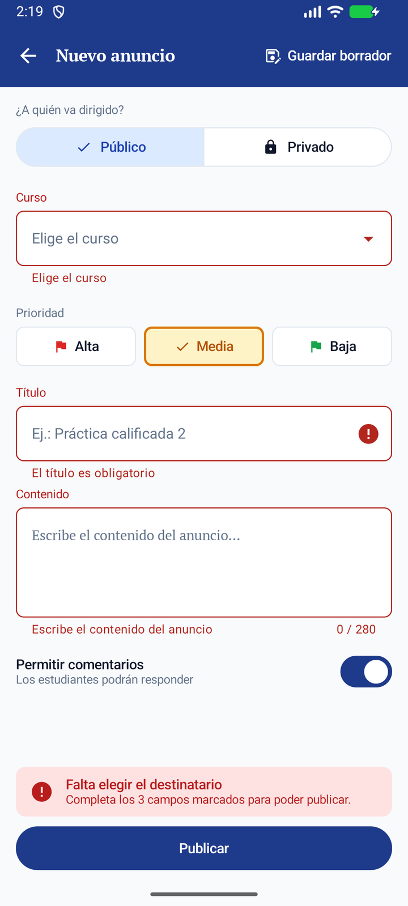 |

**Mejora:** antes, publicar con campos vacíos no hacía nada. Ahora cada campo muestra su error (`isError` + `supportingText`) y el resumen se vuelve rojo e indica qué falta.

### Gestión: archivar y cerrar comentarios

| Menú ⋮ | Archivados | Antes: comentarios | Después: comentarios cerrados |
|---|---|---|---|
| 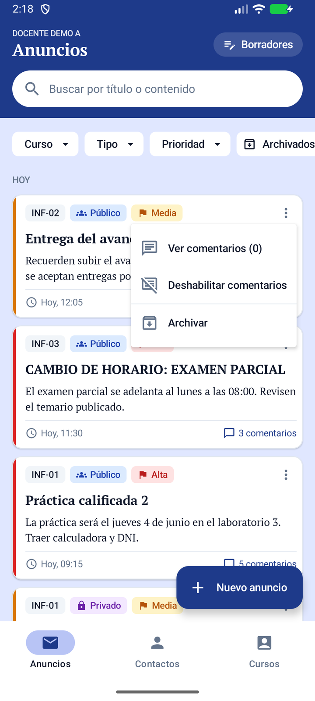 | 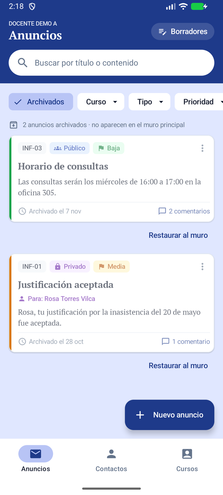 | 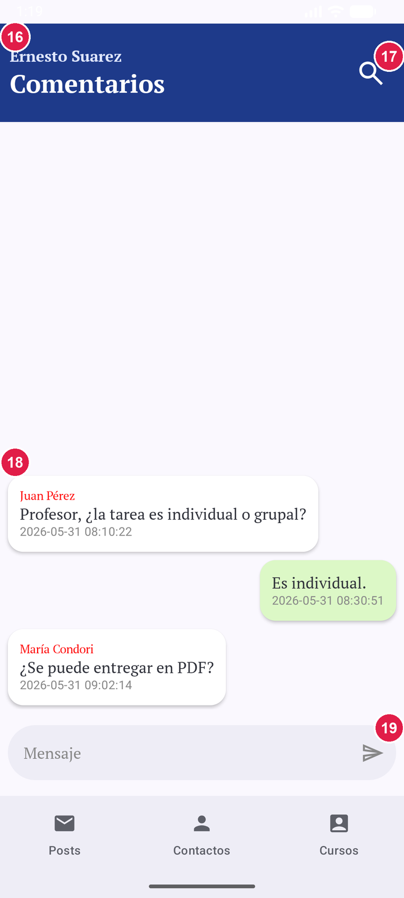 | 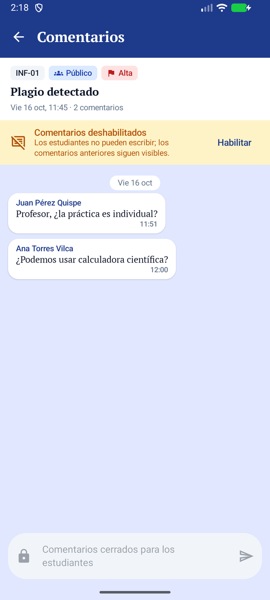 |

**Mejora:**
- **Menú ⋮:** «Ver comentarios», «Deshabilitar/Habilitar comentarios» y «Archivar».
- **Archivar:** sin diálogo; se puede **deshacer** desde el Snackbar.
- **Vista de archivados:** las tarjetas aparecen atenuadas, con «Restaurar al muro».
- **Pantalla de comentarios:**
  - Muestra el anuncio arriba y tiene flecha atrás.
  - Si están cerrados, un aviso lo explica (el docente tiene «Habilitar»), los comentarios previos siguen visibles y la entrada queda bloqueada con un candado.
  - Los nombres ya no aparecen en rojo.

### Borradores locales (Tarea 3)

| Guardar al salir | Lista de borradores | Formulario público |
|---|---|---|
| 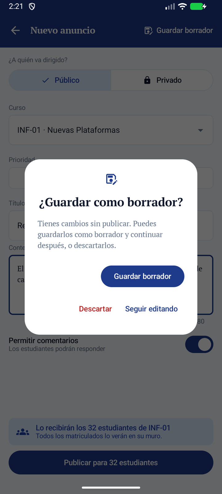 | 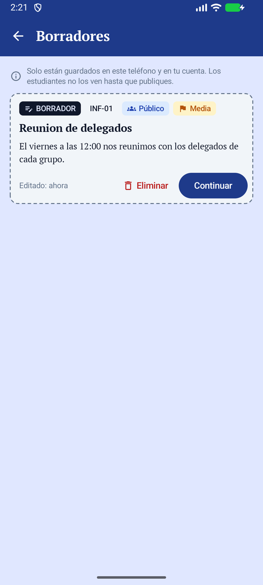 | 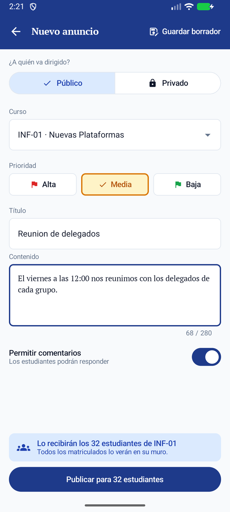 |

**Mejora:**
- **Guardar:** «Guardar borrador» está siempre en la barra superior del formulario. Si se sale con cambios, la app pregunta *Guardar borrador / Descartar / Seguir editando*.
- **Pantalla «Borradores»:**
  - Se abre con el botón «Borradores» de la cabecera, que muestra un contador.
  - Los borradores se distinguen de los anuncios publicados por el borde discontinuo, el fondo gris y la etiqueta BORRADOR.
  - Tiene «Continuar» y «Eliminar» (con opción de deshacer).
- **Persistencia en Room:** los borradores se conservan al cerrar y reabrir la app.
- **Aislamiento por cuenta:** cada cuenta (correo de la sesión) ve solo sus borradores. Al cambiar de cuenta, los de la anterior se conservan y la otra no puede verlos, abrirlos ni borrarlos.
- **Al publicar** un borrador, este se elimina de la lista.

---

## Arquitectura

Se respeta la arquitectura **MVVM** existente: Hilt, ViewModels con `StateFlow`, repositorios en `data/repository` y fuentes de datos en `data/remote`.

```
UI (Compose)                      ViewModel (StateFlow)           Datos
──────────────────────────────    ────────────────────────────    ──────────────────────────────────────
screen/post/PostScreen ────────▶  PostViewModel ───────────────▶ PostRepository ─┬─ PostRepositoryImpl → Supabase (REAL)
  components/AnuncioCard            MuroUiState, FiltroMuro        (interfaz)      │    + PostExtraDao (Room, SIMULADO)
  components/MuroComponents         eventos (Snackbar)                             └─ DemoPostRepository → Room (SIMULADO, modo demo)
screen/post/nuevo/
  NuevoAnuncioScreen ──────────▶  NuevoAnuncioViewModel ───────▶ PostRepository, ContactRepository, DraftRepository
  SelectorEstudianteSheet           FormUiState, validación
screen/post/borradores/
  BorradoresScreen ────────────▶  BorradoresViewModel ─────────▶ DraftRepository → DraftDao (Room, REAL/local)
screen/post/PostCommentScreen ──▶  PostCommentViewModel ────────▶ CommentRepository, PostRepository
domain/muro/  FiltroMuro · TextoBusqueda (búsqueda sin tildes + resaltado) · FechaAmigable   ← lógica pura con pruebas
data/di/RepositorySelectorModule  → elige la implementación real o la demo según BuildConfig.DEMO_MODE
data/local/AppDatabase (Room v5)  → notificaciones (original) · post_extra · demo_post · demo_comment · drafts
```

- **Room:** la base pasó de v2 a v5 con **migraciones reales**: 2→3, 3→4 y 4→5. No se usa `fallbackToDestructiveMigration`, así que se conservan las notificaciones guardadas. Los esquemas están en `AlertaUNI/app/schemas/`.
- **Componentes experimentales de Material 3:** `SingleChoiceSegmentedButtonRow`, `ModalBottomSheet`, `ExposedDropdownMenuBox` y `stickyHeader` se usan con `@OptIn`.

## Real vs. simulado

| Capacidad | Modo real (credenciales en `local.properties`) | Modo demo (`alertauni.demo=true`, solo debug) |
|---|---|---|
| Iniciar sesión | **Real**: Google + Supabase Auth | **Simulado**: botones «Docente Demo A/B» |
| Listar anuncios | **Real**: `service-posts` | **Simulado**: Room `demo_post` con 40 anuncios de prueba |
| Publicar público | **Real**: `service-post-add` (requiere desplegar la corrección incluida) | **Simulado**: Room |
| Publicar privado (`receiver_private`) | **Real**: `service-post-private-add` | **Simulado**: Room |
| Estudiantes de un curso | **Real**: `service-course-student` | **Simulado**: `DemoData` |
| Comentarios (ver y enviar) | **Real**: `service-comments`, `service-comment-add` | **Simulado**: Room `demo_comment` |
| Prioridad | **Simulado**: tabla local `post_extra` (el backend no tiene `priority`) | **Simulado** |
| Archivar / restaurar | **Simulado**: `post_extra.archivedAt`, solo en este dispositivo | **Simulado** |
| Habilitar / deshabilitar comentarios | **Simulado**: `post_extra.allowComments`, solo en este dispositivo (no hay endpoint) | **Simulado**: también bloquea el envío de comentarios |
| Nombre del destinatario («Para: …») | **Simulado**: se guarda localmente al publicar (`get_posts_fun` no lo devuelve) | **Simulado** |
| Búsqueda y filtros | **Real en el cliente**: filtra la lista ya cargada | Igual |
| **Borradores** | **Local real**: Room `drafts` (lo pide el enunciado) | Igual |

- **Marcas en el código:** todo lo simulado lleva el comentario `// SIMULADO:` o el prefijo `Demo…`.
- **Errores corregidos en el backend (sin desplegar):** en `service-post-add` se declaró `courseCatalogIDs` y se corrigió el `catch`. El equipo no tuvo acceso al proyecto Supabase.
- **Notificaciones push por prioridad alta:** se plantearon en el examen como idea futura; **no se implementaron**.

## Resultados de las pruebas

**Funcionamiento.** Se probó con **40 anuncios** de prueba variados, en el emulador y en modo demo:

| Tipo | Resultado |
|---|---|
| Pruebas automáticas (`./gradlew testDebugUnitTest`) | **21 / 21 aprobadas**: búsqueda sin tildes y resaltado, filtros, fechas, migraciones 2→5, variedad de los datos de prueba y borradores (guardar, recuperar, persistencia, aislamiento entre cuentas, deshacer) |
| Casos manuales en el emulador | **27 aprobados**: muro, búsqueda, filtros, archivar/deshacer/restaurar, menú, comentarios cerrados y habilitar, validación, selector de estudiante, confirmación, publicación pública y privada, atajo desde Contactos, borradores (guardar, salir con cambios, continuar, persistencia tras reiniciar, aislamiento A/B) |
| Regresión en el emulador | **4 aprobados**: navegación inferior, comentarios, Contactos y Cursos |

**Usabilidad (≥ 2 personas ajenas al equipo).** *Pendiente:* los resultados reales se agregarán aquí al aplicar la prueba. Habrá tres tareas:
1. Encontrar «Práctica calificada 2».
2. Preparar un anuncio privado para un estudiante.
3. Guardar un borrador y recuperarlo.

Se medirá si completan cada tarea, el tiempo, los errores, si piden ayuda y, opcionalmente, SEQ y SUS.

## Decisiones del diseño del examen

**Se mantuvieron:**
- Formulario único con selector segmentado y confirmación solo para privados.
- Resumen del destinatario repetido en el botón.
- Búsqueda fija con chips combinables y agrupación por fecha.
- Tarjeta con doble codificación de la prioridad, chip con **ícono y palabra**, sin autor y con fecha amigable.
- Menú ⋮ y archivar con «Deshacer».
- Comentarios cerrados con aviso y entrada bloqueada.
- FAB extendido y `contentPadding` de 88 dp.
- Colores y tipografías tomados de Figma.

**Se modificaron, con su razón:**
1. **Prioridad, archivado, comentarios y nombre del destinatario** se guardan localmente (SIMULADO), porque el backend no los soporta y no hubo acceso a Supabase.
2. **Se agregaron «Borradores»**, un requisito nuevo de la Parte 2 que no estaba en Figma:
   - Botón «Guardar borrador» en la barra superior.
   - Diálogo al salir con cambios.
   - Pantalla propia con tarjetas de borde discontinuo.
   - Para que quepa la acción, el título de la barra usa un tamaño menor que en Figma.
3. **Se agregó el botón «Borradores» con texto y contador** en la cabecera del muro, en vez de solo un ícono, para que la tarea de usabilidad 3 sea descubrible.
4. **«Esta semana»** se calcula como «los últimos 7 días» y las fechas del backend se interpretan en **UTC** y se muestran en hora de Perú (supuesto documentado en `FechaBackend`).
5. **El ícono Enviar de Contactos** ahora abre el mismo formulario con el destinatario preseleccionado, en lugar de un diálogo aparte.
6. **El tema usa siempre la paleta de la marca** (`dynamicColor = false`, modo claro): el color dinámico pintaba el FAB y la barra con el fondo de pantalla.
7. **La pantalla de comentarios no tiene el menú ⋮** que había en Figma; habilitar o deshabilitar se hace desde el aviso o desde el menú de la tarjeta.

Los cambios por resultados de usabilidad se documentarán aquí cuando se hagan las pruebas.

## Cómo compilar y ejecutar

1. Abre `AlertaUNI/` en Android Studio y elige el JDK 17 en *Settings → Build Tools → Gradle → Gradle JDK*.
2. Copia `AlertaUNI/local.properties.example` a `local.properties`, que no se sube a git. Hay dos formas de usarlo:
   - **Modo demo, sin backend:** `alertauni.demo=true`. Al abrir la app, elige «Entrar como Docente Demo A» (o B).
   - **Modo real:** completa `supabase.url`, `supabase.key` y `google.webClientId`, pon `alertauni.demo=false` y coloca tu `google-services.json` en `AlertaUNI/app/`, que también está fuera de git.
3. El proyecto usa el plugin de Google Services, que exige un `google-services.json` en `AlertaUNI/app/` también en modo demo. Si no tienes uno, cualquier archivo válido con el paquete `com.erns.alertauni` sirve para compilar.
4. Ejecuta `Run ▶` (variante debug). Para las pruebas: `./gradlew testDebugUnitTest`.

---
*Proyecto académico: curso Introducción al Desarrollo de Nuevas Plataformas, UNSA. Los nombres de estudiantes del modo demo son ficticios.*
